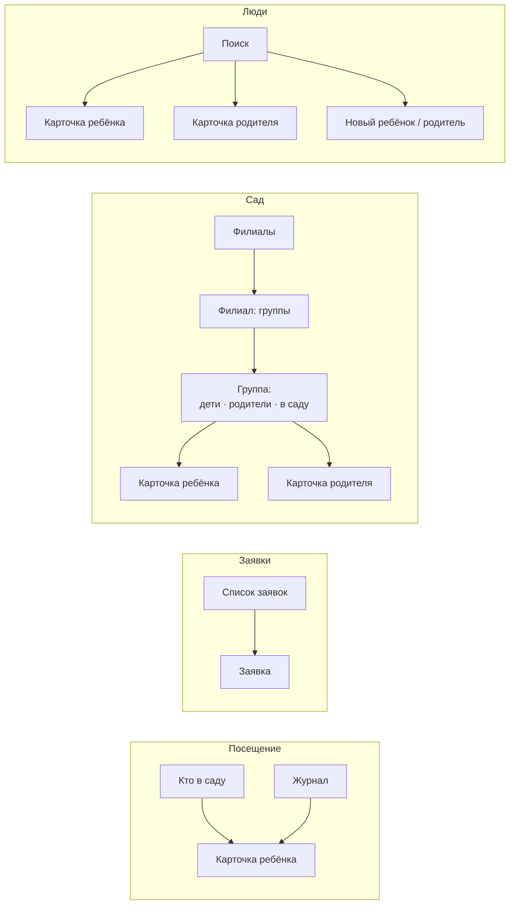

# Экраны администратора

25.09.2026 · Darya Nesterova

После входа пользователь с ролью `ADMIN` попадает в раздел администратора. Там он подтверждает заявки на регистрацию, заводит детей и родителей, связывает их, ведёт филиалы и группы и видит, кто сейчас в саду. Если администратор ещё и родитель, он может переключиться в режим родителя.

**Статус: сделаны каркас, «Посещение» (с выбором филиала и составом групп), «Заявки», «Сад» (`docs/garden-screen.md`); «Люди» — список детей, родителей и сотрудников.** Реализованы вкладки администратора, переключение между режимами администратора и родителя (раздел «Администратор-родитель»), первые версии «Посещения» и «Заявок» на текущем API (см. «Что сделано» в этих разделах). Вкладка «Сад» — филиалы, группы и их состав, «Люди» — список детей, родителей и сотрудников с поиском, во вкладке «Ещё» есть профиль (со сменой пароля), «Режим родителя» и «Выйти». Остальное пока только проработано. API сверено со стендом `http://93.77.168.178/api/v3/api-docs` и кодом `visit-control-service` на 25.09.2026. Примерно половину экранов можно сделать на текущем API. Остальным нужны доработки бэкенда, они собраны в разделе «Что нужно на бэкенде».

## Куда попадает пользователь после входа

Роль приходит в `GET /user` (`role.role`) и уже лежит в `state.auth.user.role`.

Директор (`DIRECTOR`) в приложении работает как администратор: те же вкладки и права (`isAdminRole` в `store/types/auth.ts`).

| Роль | Экран после входа |
| --- | --- |
| `ADMIN`, `DIRECTOR` | режим, в котором он работал в прошлый раз; при первом входе — вкладка «Посещение» (см. «Администратор-родитель») |
| `PARENT` | «Мои дети» (`docs/children-screen.md`) |
| остальные | «Приложение пока работает для родителей и администраторов» и кнопка «Выйти» |

Проверка роли на клиенте только выбирает экраны, настоящая защита — права на бэкенде.

## Администратор-родитель

Администратор сада часто водит в этот же сад своих детей. Утром он приводит ребёнка, отмечает приход и сразу переходит к работе, вечером наоборот. Поэтому у него два режима в одном аккаунте:

- **режим администратора** — вкладки «Посещение», «Заявки», «Сад», «Люди», «Ещё»;
- **режим родителя** — ровно тот же экран «Мои дети», что у обычного родителя (`docs/children-screen.md`), ничего дополнительного.

Режим — только способ показа. Права не меняются: токен тот же, и в режиме родителя бэкенд по-прежнему видит администратора. Разделение нужно, чтобы утренняя отметка своего ребёнка занимала два тапа, а не поиск себя в «Людях», и чтобы родительский экран не смешивался с рабочими списками.

### Когда доступен режим родителя

Переключатель показывается, только если у администратора есть свои дети: после входа приложение в фоне запрашивает `GET /child-representative/children` со своим ключом. Пустой ответ — переключателя нет, и администратор без детей ничего лишнего не видит. Связь создаётся так же, как для любого родителя, в том числе самим администратором из своей карточки в «Людях».

**Сейчас в API:** всё есть. У `ADMIN` все права, включая `CHILD_REPRESENTATIVE_READ` и `VISIT_WRITE`, а `POST /visit` проверяет только наличие связи ребёнка с представителем.

### Как переключаться

```
Режим администратора → «Ещё»          Режим родителя → «⋯» в шапке
┌─────────────────────────────────┐   ┌─────────────────────────────────┐
│  Ещё                            │   │  Мои дети                   ⋯   │
│                                 │   │                                 │
│  ┌───────────────────────────┐  │   │  ┌───────────────────────────┐  │
│  │ 👪 Режим родителя       › │  │   │  │ Мария Иванова             │  │
│  │    Мария, Пётр            │  │   │  │ ○ Не в саду               │  │
│  └───────────────────────────┘  │   │  │ [    Привела в сад    ]   │  │
│                                 │   │  └───────────────────────────┘  │
│  Сменить пароль               › │   │                                 │
│  Выйти                          │   │  ┌───────────────────────────┐  │
│                                 │   │  │ Режим администратора      │  │
│                                 │   │  │ Выйти                     │  │
│                                 │   │  │ Отмена                    │  │
│                                 │   │  └───────────────────────────┘  │
└─────────────────────────────────┘   └─────────────────────────────────┘
```

- **В режим родителя:** первая строка вкладки «Ещё», крупная, с именами детей. Два тапа: «Ещё» → «Режим родителя».
- **Обратно:** «⋯» в шапке «Мои дети» → «Режим администратора». У обычного родителя в этом меню только «Выйти», поэтому пункт появляется лишь при роли `ADMIN` или `DIRECTOR`.
- Переключение без подтверждения и без перезагрузки данных: это не выход из аккаунта, ошибиться тут нечем.
- Отдельную вкладку «Мои дети» в нижней панели не делаем: вкладок уже пять, а шестая станет нечитаемой. К тому же родительский экран внутри рабочих вкладок снова смешает два контекста.

### Какой режим открывается при входе

Приложение запоминает последний режим и открывает его при следующем входе. Утром администратор отметил ребёнка в режиме родителя и не переключился — при следующем открытии он снова в режиме родителя, одно переключение. Если бы всегда открывался режим администратора, отмечать ребёнка пришлось бы через лишний шаг каждый раз.

Если запомнен режим родителя, а детей у администратора больше нет (связи удалили), открывается режим администратора.

Режим хранится на устройстве вместе с сессией: `expo-secure-store` всё равно появится для токена (этап 1 в `backend-integration.md`). Пока сессия живёт только в памяти, режим тоже сбрасывается при перезапуске, и при каждом входе открывается «Посещение».

### Как выглядят отметки администратора

В журнале и в карточке ребёнка отметка администратора-родителя выглядит как у любого родителя: «привела Иванова А.». Отдельной пометки «администратор» не нужно: он действовал как представитель своего ребёнка.

Отметка чужого ребёнка из режима администратора (например, родитель забыл отметить) — другой сценарий, он в открытых вопросах. Если его сделают, в журнале такие отметки нужно помечать «отметил администратор», чтобы родитель не удивлялся, что «привёл» кто-то чужой.

### Что меняется в приложении

| Файл | Изменение |
| --- | --- |
| `store/reducers/auth.ts` | поле `mode: 'admin' \| 'parent'` и action `switchMode`; для `PARENT` всегда `'parent'` |
| `store/sagas/auth.ts` | после входа администратора — фоновая загрузка своих детей, чтобы знать, показывать ли переключатель; при `switchMode` — сохранение режима |
| `app/auth.tsx` | после входа маршрут выбирается по `role` и `mode`, а не только по роли |
| `app/children.tsx` | «Выйти» в шапке заменяется на меню «⋯»: «Режим администратора» (только `ADMIN`) и «Выйти» |
| `app/(admin)/more/index.tsx` | строка «Режим родителя» с именами детей, если дети есть |

Переключение — `router.replace` на `/children` или `/(admin)/visits`. Стеки вкладок администратора при этом сбрасываются, но данные остаются в кэше RTK Query, и при возврате экраны открываются сразу, без спиннера.

Список детей для «Мои дети» и для строки в «Ещё» — один и тот же slice `children`. Загруженный в фоне список сразу виден при переключении.

## Сотрудник

Роль `EMPLOYEE` — воспитатель или другой сотрудник сада с доступом к приложению (с 28.09.2026).

- **Видит весь сад:** рабочий режим с вкладками «Посещение» (кто в саду по филиалам и группам, журнал) и «Ещё» (профиль, режим родителя, выход).
- **Не видит и не может:** «Заявки», «Сад», «Люди» — не создаёт людей, не одобряет заявки на регистрацию, не ведёт филиалы и группы. На бэкенде это закрыто правом `USER_WRITE` (и `BRANCH_WRITE`), которого у сотрудника нет; в приложении эти вкладки скрыты.
- **Может быть родителем в этом саду.** Переключение режимов такое же, как у администратора-родителя (раздел выше): «Ещё» → «Режим родителя», обратно — «⋯» в «Мои дети» → «Режим сотрудника». В токене у человека одна роль, поэтому у `EMPLOYEE` есть и права родителя: `VISIT_WRITE`, `CHILD_REPRESENTATIVE_READ`/`WRITE`. Отметить можно только своего ребёнка: `POST /visit` проверяет связь ребёнка с представителем.
- Права: `PRESENCE_READ`, `VISIT_READ`, `GROUP_READ`, `BRANCH_READ` + родительские. Миграция `2026-09-28-employee-role.xml`.
- **В приложении:** «роль персонала» (`isStaffRole` в `store/types/auth.ts`) — администратор или сотрудник: у них рабочий режим и переключение в режим родителя, свои дети загружаются сразу после входа. Вкладки только для администратора скрыты через `href: null` в `app/(admin)/_layout.tsx`.

## Вкладки

Пять вкладок внизу экрана: больше в нижнюю панель не помещается без сокращений.

| Вкладка | Что внутри | Зачем отдельная вкладка |
| --- | --- | --- |
| **Посещение** | кто сейчас в саду по группам и журнал отметок | самые частые вопросы: сколько детей, кто где, кто кого привёл и забрал |
| **Заявки** | заявки на регистрацию; число ожидающих — на значке вкладки | ежедневная работа, должна быть в один тап |
| **Сад** | филиалы → группы → состав группы | структура сада и работа с группами |
| **Люди** | дети, родители и сотрудники: поиск, создание, карточки | когда нужен конкретный человек, а не группа |
| **Ещё** | мои дети, смена пароля, выход | редкие действия |

```
┌─────────────────────────────────────┐
│                                     │
│            (содержимое)             │
│                                     │
├─────────┬───────┬──────┬──────┬─────┤
│    ◉    │  ✉ 3  │  ⌂   │  👤  │  ⋯  │
│Посещение│Заявки │ Сад  │ Люди │ Ещё │
└───────┴───────┴───────┴──────┴──────┘
```

Внутри каждой вкладки свой стек экранов: из «Сад» можно уйти вглубь до карточки ребёнка, переключиться на «Заявки» и вернуться в «Сад» туда же, где был.



Карточки ребёнка и родителя — одни и те же экраны, открытые из разных вкладок.

## Посещение

Вверху экрана переключатель из двух частей (`segmented-control`): «Кто в саду» и «Журнал». Вкладка помнит последний выбранный режим.

### Очередь

С 12.10.2026, если в саду включено подтверждение посещений (`visit_confirmation` в `GET /organization/current`), у переключателя появляется третий режим — «Очередь N». В нём отметки родителей «Привела» и «Забрала», которые ждут сотрудника: «Принять», «Отдать» или «Отклонить» с причиной. Сотрудник выбирает свои группы («Изменить»), выбор хранится на устройстве; сколько ждут в остальных группах — строкой под списком. Очередь открывается первой, пока в ней кто-то ждёт, и перечитывается раз в 15 секунд. Свою отметку сотрудник-родитель подтвердить не может.

Полное описание — `visit-control-service/docs/visit-confirmation.md`. Код: `components/visit-queue.tsx`, slice и saga `visit-queue`, `utils/visit-queue.ts`, `services/visits/queue-filter.ts`. «Отметить без телефона родителя» пока не сделано.

В очереди есть кнопка «Сканировать QR-код родителя» (`components/qr-scanner-sheet.tsx`, `expo-camera`): один скан — ребёнок принят или отдан, на экране «Принято: Мария Иванова» и кто привёл. Если доступа к камере нет, сканер предлагает разрешить её или открыть настройки; кнопки в очереди работают в любом случае.

### Кто в саду

```
Посещение                             Центральный
┌─────────────────────────────────┐   ┌─────────────────────────────────┐
│  ┌──────────────┬────────────┐  │   │ ‹ Назад     Центральный         │
│  │ Кто в саду ● │   Журнал   │  │   │                                 │
│  └──────────────┴────────────┘  │   │  В саду 23 из 40                │
│                                 │   │                                 │
│  В саду 31 ребёнок              │   │  РОМАШКА · 15 ИЗ 18             │
│  ┌───────────────────────────┐  │   │  ● Мария Иванова                │
│  │ Северный      8 из 20   › │  │   │  ● Пётр Смирнов                 │
│  │ 2 группы                  │  │   │  …                              │
│  │ Центральный  23 из 40   › │  │   │  СОЛНЫШКО · 8 ИЗ 15             │
│  │ 3 группы                  │  │   │  …                              │
│  │ Без группы            1 › │  │   │  ЗАЙЧИК · 0 ИЗ 7                │
│  └───────────────────────────┘  │   │  Сейчас никого нет              │
└─────────────────────────────────┘   └─────────────────────────────────┘
```

- Сначала выбор филиала: у каждого «в саду / всего детей в группах» и число групп. Нажатие открывает филиал, где дети разбиты по группам, у группы — «сейчас / всего». Группы без детей тоже показываются — «Новая» и под ней «Детей пока нет»: иначе администратор не найдёт только что созданную группу.
- Если филиал один и все дети в группах, выбора нет: группы сразу на вкладке.
- **«Без группы»** — отдельной строкой в конце списка филиалов. Это дети в саду, которые не состоят ни в одной группе: без группы у ребёнка нет и филиала, поэтому их нельзя показать внутри филиала.
- **«Другие группы»** — если у группы филиал, которого нет в `GET /branch/list` (например, закрыт). Так ни один ребёнок в саду не пропадёт из подсчёта.
- **Изменить** у заголовка каждой группы — только у администратора (у сотрудника ссылки нет). Открывает «Состав группы» (см. ниже): добавить, перевести и убрать детей.
- Обновление: потянуть вниз и при каждом возврате на вкладку или на экран филиала, как на «Мои дети».
- Нажатие на ребёнка откроет его карточку, когда она появится.
- **API:** один запрос `GET /group/presence` без фильтра (все активные группы с `branch_external_key`, `total_children`, `present`, плюс `without_group` и `total_present`) и `GET /branch/list` для названий. Разбивка по филиалам — на клиенте: так одним запросом известны счётчики всех филиалов для экрана выбора, а экран филиала открывается без загрузки. Фильтр `branch_external_key` у `/group/presence` не используем: он всё равно не отделяет детей без группы, `without_group` приходит одинаковым при любом филиале.

### Состав группы

```
┌─────────────────────────────────────┐
│  Состав группы              Готово  │
│  «Солнышко» · Центральный           │
│  🔍 Фамилия, имя                    │
│  ┌──────────┬────────────┬────────┐ │
│  │В группе ●│ Без группы │Все дети│ │
│  └──────────┴────────────┴────────┘ │
│  Иванова Мария          [ Убрать ]  │
│  Солнышко · 4 года                  │
│  Смирнов Пётр           [ Убрать ]  │
│  Солнышко · 5 лет                   │
└─────────────────────────────────────┘
```

- Модальный экран из «Посещения» по ссылке «Изменить» у группы и из «Сада» (`components/group-members-screen.tsx`, маршруты `visits/group-members.tsx` и `garden/group-members.tsx` — в стеке своей вкладки). Группа с детьми открывается на «В группе», пустая — сразу на «Без группы»: новую группу обычно заполняют ими. «Все дети» — чтобы перевести ребёнка из другой группы.
- **Ребёнок состоит в одной группе.** Нажатие на ребёнка без группы добавляет его сразу. Если он в другой группе — подтверждение «Перевести в „Солнышко“? Иванова Мария сейчас в группе „Ромашка“».
- **Убрать из группы — только с подтверждением**, чтобы нельзя было сделать это случайно:
  - строка ребёнка группы не нажимается, убрать можно только отдельной красной кнопкой «Убрать»;
  - затем диалог «Убрать из группы „Солнышко“?» с объяснением, что ребёнок останется без группы, кнопки «Отмена» и «Убрать» (destructive). Запрос уходит только после «Убрать»;
  - ребёнок остаётся в списке с «Без группы» и «＋» — если убрали по ошибке, вернуть можно одним нажатием.
- Экран не закрывается после изменений, можно менять следующего. Закрыть — «Готово» или свайп вниз.
- Ошибка — красным под именем ребёнка («Не удалось добавить. Повторить», «Не удалось убрать из группы. Повторить», «Ребёнок или группа удалены. Обновите список»).
- Создать нового ребёнка отсюда пока нельзя — ждёт «Нового ребёнка» во вкладке «Люди».
- **API:** дети — `GET /user/people?category=CHILD` с `group_external_key` («В группе»), `without_group=true` («Без группы») или без фильтра, поиск `q`, страницы. Изменения — только администратор (`USER_WRITE`):
  - `PUT /group/{key}/children/{child_key}` — добавляет в группу, в том числе пустую, из прежней группы переводит, повтор ничего не меняет; 404 — группа или ребёнок удалены, 400 — не ребёнок;
  - `DELETE /group/{key}/children/{child_key}` — убирает из группы, 204; если ребёнка в группе уже нет (например, его перевели, пока админ подтверждал), ничего не меняет. Запись о составе удаляется, а не помечается `DELETED`: уникальный индекс `(группа, пользователь, статус)` не дал бы убрать ребёнка из той же группы второй раз.
  - После изменения приложение перечитывает «Кто в саду» и, если открывался, список «Людей».

### Журнал

```
┌─────────────────────────────────────┐
│  Посещение                          │
│  ┌────────────────┬──────────────┐  │
│  │   Кто в саду   │   Журнал ●   │  │
│  └────────────────┴──────────────┘  │
│  Сегодня                            │
│  РОМАШКА · 2 РЕБЁНКА                │
│  ○ Мария Иванова                    │
│    08:40 → 17:30                    │
│    Приход — Иванова А. · Уход — Иванов С. │
│  ● Пётр Смирнов                     │
│    08:55 → ещё в саду               │
│  СОЛНЫШКО · 1 РЕБЁНОК               │
│  …                                  │
│  БЕЗ ГРУППЫ · 1 РЕБЁНОК             │
│  …                                  │
│  Вчера, 28 сентября                 │
│  …                                  │
└─────────────────────────────────────┘
```

- **День → группа → ребёнок.** Дни — новые сверху. Внутри дня — группы по названию, «Без группы» в конце; в заголовке группы — сколько детей из неё было в этот день (и филиал, если филиалов несколько). В группе — по строке на ребёнка, по имени.
- Строка ребёнка: ● сейчас в саду / ○ нет; когда пришёл и ушёл («08:40 → 17:30», «08:55 → ещё в саду», несколько пребываний за день — через запятую); кто отметил первый приход и последний уход: «Приход — Иванова А. · Уход — Иванов С.». Без глаголов «привела / забрал»: пол представителя сервер не отдаёт.
- Прошлый день, где после прихода нет ухода, — «09:00 → уход не отмечен». Если день оборвался на границе страницы и приход ещё не загружен — «? → 17:30»; строка дополнится после подгрузки.
- **Группа — нынешняя**, а не та, в которой ребёнок был в день отметки: истории состава групп в БД нет. Ребёнка, которого перевели, старые дни покажут в новой группе.
- Подгрузка страницами по 100 отметок при прокрутке (`onEndReached`), обновление — потянуть вниз.
- Потом: фильтры по дате и группе, переход в карточку ребёнка, «Вся история» из карточки.
- **API:** `GET /visit/list?sortBy=created&sortOrder=DESC` — лента всего сада страницами, с ФИО ребёнка и представителя, временем и с 29.09.2026 — `group` (нынешняя группа ребёнка: `external_key`, `name`, `branch_external_key`, `branch_name`; нет — без группы). Разбивка по дням, группам и детям — на клиенте (`utils/journal.ts`). Время приходит без часового пояса, бэкенд пишет его в UTC — переводим в местное при показе. На старом бэкенде без `group` все дети попадают в «Без группы».

### Что сделано

`app/(admin)/visits/`: у вкладки свой стек — `index.tsx` (переключатель, филиалы, журнал) и `branch/[id].tsx` (филиал по группам):

- переключатель «Кто в саду / Журнал»; режим помнится, пока открыта вкладка;
- «Кто в саду» — список филиалов «Центральный · 23 из 40 · 3 группы», «Без группы» и при необходимости «Другие группы»; в филиале дети по группам: «Солнышко · 8 из 15», у группы, где сейчас никого, «Сейчас никого нет», у группы без детей — «Детей пока нет». При одном филиале группы сразу на вкладке. Разбивка — `utils/presence.ts`, общие списки — `components/visit-list.tsx`. На бэкенде без `GET /group/presence` (404) приложение показывает общий алфавитный список из `/group/children/present`;
- «Журнал» — `GET /visit/list` по 100 записей, день → группа → по строке на ребёнка: «Мария Иванова / 08:40 → 17:30 / Приход — Иванова А. · Уход — Иванов С.» (`utils/journal.ts`), подгрузка при прокрутке, «Повторить», если следующая страница не загрузилась;
- администратор меняет состав группы (в том числе пустой): добавляет, переводит из другой и убирает с подтверждением — «Изменить» → `components/group-members-screen.tsx`, slice и saga `group-membership`, хук `hooks/use-open-group-members.ts`;
- оба режима обновляются при возврате на вкладку, при переключении режима и если потянуть вниз;
- у отметок нет своего id, ключ строки — ребёнок + время + статус. При подгрузке повторы отбрасываются: страницы считаются по смещению, и новые отметки сдвигают их.

Пока нет: фильтров журнала, перехода в карточку ребёнка (карточка ещё не сделана).

Данные — slice и saga `visits`, как у «Мои дети». RTK Query, предложенный в «Реализации в приложении», пока не вводили.

## Заявки

```
┌─────────────────────────────────────┐
│  Заявки                             │
│                                     │
│  Иванова Мария Петровна             │
│  maria@mail.ru · +7 912 345-67-89   │
│  24 сентября, 18:40               › │
│  ─────────────────────────────────  │
│  Смирнов Олег                       │
│  …                                  │
└─────────────────────────────────────┘

┌─────────────────────────────────────┐
│  ← Заявка                           │
│                                     │
│  Иванова Мария Петровна             │
│  Дата рождения   12.03.1990         │
│  Пол             женский            │
│  Email           maria@mail.ru      │
│  Телефон         +7 912 345-67-89   │
│  Подана          24.09.2026 18:40   │
│                                     │
│  ┌───────────────────────────────┐  │
│  │          Подтвердить          │  │
│  └───────────────────────────────┘  │
│           Отклонить                 │
└─────────────────────────────────────┘
```

- Список — `GET /registration/requests` с пагинацией, число на значке вкладки — `totalElements`.
- «Подтвердить» → `POST /registration/requests/{key}/approve`. После ответа экран предлагает следующий шаг: «Мария может войти. Привязать её к ребёнку?» → поиск ребёнка (см. «Связь ребёнка и представителя»). Без связи родитель увидит пустой экран «Мои дети».
- Если в ответе `password_sent: false`, показываем «Письмо с паролем не отправилось» и кнопку «Отправить пароль ещё раз» (`POST /user/{key}/password/reset`).
- «Отклонить» → диалог с необязательной причиной (до 500 символов) → `POST /registration/requests/{key}/reject`.
- Похожий пользователь уже есть (тот же телефон или ФИО и дата рождения) — предупреждение над кнопками. **Нужен бэкенд**: сейчас сервер проверяет только занятость email и телефона при подаче.
- **Сейчас в API:** всё, кроме проверки на дубли, есть.

### Что сделано

`app/(admin)/requests/`: свой стек «список → заявка», slice и saga `requests`.

- Значок с числом заявок на вкладке. Заявки грузятся сразу при входе в режим администратора и при каждом открытии вкладки.
- Список: старые сверху (так сортирует сервер), ФИО, email, телефон, когда подана. Загружается одна страница на 100 заявок. Следующие страницы по смещению пропускали бы заявки: после подтверждения заявка уходит из выборки, и остальные сдвигаются. Если заявок больше 100, над списком написано «Показаны первые 100 из N».
- Заявка: ФИО, дата рождения с возрастом, пол, email, телефон, дата подачи. Email и телефон можно выделить и скопировать.
- «Подтвердить» — с диалогом «на maria@mail.ru придёт письмо с паролем». После ответа экран показывает результат, а если письмо не ушло — кнопку «Отправить пароль ещё раз».
- «Отклонить» раскрывает поле причины (необязательно, до 500 символов, счётчик) и красную кнопку «Отклонить заявку».
- 404 и 409 `ALREADY_PROCESSED` — «Заявка уже обработана: её подтвердил или отклонил другой администратор». Заявка уходит из списка.
- Нет сети или таймаут — диалог с советом обновить список: запросы подтверждения и отказа не повторяются, и неизвестно, дошли ли они.

Пока нет: предупреждения о возможном дубле самого заявителя.

### Роль и дети в заявке

10.10.2026. Заявитель регистрируется родителем или сотрудником, родитель сразу указывает детей (`docs/registration-screen.md`, «Роль и дети»; бэкенд — `visit-control-service/docs/self-registration.md`).

```
┌─────────────────────────────────────┐
│  Иванова Ольга                      │
│  Роль        Родитель      Сменить  │
│  …                                  │
├─────────────────────────────────────┤
│  2 ребёнка в заявке                 │
│                                     │
│  Иванова Маша                       │
│  01.05.2022 (4 года) · женский      │
│  ○ Это Петрова Маша, 01.05.2022 —   │
│    уже в саду                       │
│  ○ Новый ребёнок — добавить в сад   │
│  ○ Не добавлять                     │
│                                     │
│  Иванов Петя                        │
│  10.01.2024 (2 года) · мужской      │
│  ● Новый ребёнок — добавить в сад   │
│  ○ Не добавлять                     │
└─────────────────────────────────────┘
```

- В списке под ФИО — роль и число детей: «Родитель · 2 ребёнка», «Сотрудник».
- Роль из заявки получит пользователь. «Сменить» открывает шторку с ролями из `GET /user/roles` (только родитель, сотрудник и администратор, если их можно выдать). Выбранная роль уходит в `role_external_key`.
- По каждому ребёнку — выбор. Похожие дети сада (`matches`: то же имя и дата рождения) показаны вариантами «Это … — уже в саду»: так второй родитель того же ребёнка не создаёт дубль. Без похожих детей по умолчанию выбрано «Новый ребёнок». С похожими — ничего не выбрано, и «Подтвердить» неактивна с подсказкой, пока администратор не решит.
- Диалог подтверждения называет роль и итог по детям: «Дети: добавить новых — 1, связать с записанными в сад — 1».
- После подтверждения экран результата сообщает, сколько детей теперь в «Моих детях» у родителя, и напоминает распределить их по группам во вкладке «Сад». Если у родителя детей в заявке не было — подсказка связать его с детьми во вкладке «Люди».

Код: `app/(admin)/requests/[id].tsx` (`ChildDecisionView`), `approveRequest({request, roleId, decisions})` и `loadRolesStart` в slice `requests`, `toApproveBody` и `getAssignableRoles` в `visit-control-api.ts`.

## Сад: филиалы и группы

Проработано и сделано 29.09.2026, подробно — `docs/garden-screen.md`. Коротко:

- филиалы → группы филиала → группа (переключатель «Дети · Родители»), плюс «Дети без группы» — распределить новых детей;
- список филиалов показывается всегда, даже если филиал один; пустые группы видны («Детей пока нет»);
- состав группы меняется на общем с «Посещением» экране «Состав группы»; удалить филиал или группу можно только пустыми;
- бэкенд для групп (создание, переименование, перенос, удаление, 409 на непустые, родители группы) сделан вместе с экранами, на стенд пока не выложен.

## Люди

Все люди сада, разделённые на три группы: **Дети**, **Родители**, **Сотрудники**. Вкладка нужна, когда администратор ищет конкретного человека: позвонить маме, проверить, кто может забирать ребёнка, отправить новый пароль. Взгляд «по группам сада» — во вкладке «Сад».

```
Дети                                  Родители                              Сотрудники
┌───────────────────────────────┐     ┌───────────────────────────────┐     ┌───────────────────────────────┐
│ Люди                        ＋ │     │ Люди                        ＋ │     │ Люди                        ＋ │
│ ┌───────────────────────────┐ │     │ ┌───────────────────────────┐ │     │ ┌───────────────────────────┐ │
│ │ 🔍 Фамилия, имя            │ │     │ │ 🔍 Фамилия, телефон, email │ │     │ │ 🔍 Фамилия, телефон, email │ │
│ └───────────────────────────┘ │     │ └───────────────────────────┘ │     │ └───────────────────────────┘ │
│ ┌───────┬──────────┬────────┐ │     │ ┌──────┬───────────┬────────┐ │     │ ┌──────┬──────────┬─────────┐ │
│ │Дети ● │ Родители │Сотрудн.│ │     │ │ Дети │Родители ● │Сотрудн.│ │     │ │ Дети │ Родители │Сотрудн.●│ │
│ └───────┴──────────┴────────┘ │     │ └──────┴───────────┴────────┘ │     │ └──────┴──────────┴─────────┘ │
│ Все группы ▾                  │     │                               │     │                               │
│ 124 ребёнка                   │     │ 187 родителей                 │     │ 6 сотрудников                 │
│ ● Иванова Мария             › │     │ Иванова Анна             📞 › │     │ Петрова Ольга            📞 › │
│   Солнышко · 5 лет            │     │ мама: Мария, Пётр             │     │ Администратор · Центральный   │
│ ○ Смирнов Пётр              › │     │ Смирнова Нина            📞 › │     │ Сидоров Иван             📞 › │
│   Ромашка · 4 года            │     │ бабушка: Пётр                 │     │ Администратор                 │
│ ○ Козлов Илья               › │     │ Козлов Олег              📞 › │     │                               │
│   Без группы                  │     │ детей не привязано            │     │                               │
│ …                             │     │ …                             │     │                               │
│ Отключённые · 3             › │     │ Отключённые · 5             › │     │ Отключённые · 1             › │
└───────────────────────────────┘     └───────────────────────────────┘     └───────────────────────────────┘
```

### Кто в какой группе

| Группа | Кто попадает | Строка списка |
| --- | --- | --- |
| **Дети** | роль пользователя `VISITOR` | ● в саду / ○ нет, ФИО, группа (с филиалом, если филиалов несколько) и возраст. Ребёнок без группы — «Без группы», чтобы администратор это заметил |
| **Родители** | все, кто связан хотя бы с одним ребёнком (`child-representative` с любой ролью связи: родитель, родственник, знакомый), а также пользователи с ролью `PARENT` без детей | ФИО, кем приходится и кому: «мама: Мария, Пётр», «бабушка: Пётр». Без связей — «детей не привязано»: обычно это только что подтверждённая заявка, которую ещё не связали с ребёнком. Кнопка 📞 звонит сразу (`tel:`) |
| **Сотрудники** | роли пользователя `ADMIN` (администратор) и `EMPLOYEE` (сотрудник: воспитатель и другой персонал с доступом к приложению) | ФИО, роль словом («Администратор», «Сотрудник») и филиал, если сотрудник закреплён за ним. Кнопка 📞 |

- **Один человек может быть в двух группах.** Администратор, который водит в сад своих детей, есть и в «Сотрудниках», и в «Родителях». Карточка у него одна.
- «Родители» — название группы в интерфейсе, хотя в ней и бабушки, и знакомые. Кем человек приходится ребёнку, видно по строке, поэтому отдельная группа «Родственники» не нужна.
- В списках только активные учётные записи. Заявки на регистрацию (`PENDING`, `REJECTED`) живут во вкладке «Заявки», удалённые после отзыва согласия (`DELETED`) не показываются нигде.
- **Отключённые** — последней строкой каждого списка, «Отключённые · 3 ›», открывают тот же список отключённых этой группы. Отдельная вкладка переключателя для них не нужна: они нужны редко, а четвёртая вкладка сделает переключатель тесным.

### Поиск и фильтры

- Одна строка поиска на все три группы. Текст сохраняется при переключении группы: «Иванова» в «Детях» и тут же в «Родителях» — частый путь «нашёл ребёнка → найди маму».
- Ищем по фамилии, имени и отчеству; в «Родителях» и «Сотрудниках» — ещё по телефону (любые цифры номера) и email. Поиск с задержкой 300 мс после ввода, пустой запрос — весь список.
- У «Детей» фильтр «Все группы ▾»: филиал → группа, плюс «Без группы». В остальных группах фильтров нет.
- Сортировка по фамилии, подгрузка страницами при прокрутке, обновление — потянуть вниз.
- Переключатель помнит последнюю группу, пока открыта вкладка. При первом открытии — «Дети».

### ＋ в шапке

Действие зависит от выбранной группы, без лишнего вопроса «кого создаём»:

| Группа | ＋ открывает |
| --- | --- |
| Дети | «Новый ребёнок» |
| Родители | «Новый взрослый» |
| Сотрудники | «Новый сотрудник» |

### Пустые состояния и ошибки

| Ситуация | Что показываем |
| --- | --- |
| В группе никого | «Детей пока нет» и кнопка «Добавить ребёнка»; «Родителей пока нет» с подсказкой, что родители обычно приходят через «Заявки»; в «Сотрудниках» пусто не бывает — там есть сам администратор |
| Поиск ничего не нашёл | «Никого не нашли по запросу „Иваноа“» и, если в другой группе есть совпадения, ссылка «Найдено в родителях: 2» |
| Ошибка загрузки | общие правила раздела: «Не удалось загрузить данные» и «Повторить» |

### API

**Сделано 28.09.2026 в `visit-control-service`:** `GET /user/people` (`PeopleController`, `PeopleServiceImpl`), только для `USER_WRITE`. На стенд ещё не выложено.

`GET /user/people?category=CHILD|PARENT|STAFF&q=&group_external_key=&without_group=&page=0&size=30`

- **Страницы** — стандартный `Page` Spring (`content`, `totalElements`, `number`, `last`), по умолчанию 30, максимум 100. Фильтры, поиск и сортировка (фамилия, имя, отчество) считаются в базе, поэтому `totalElements` честный — это «124 ребёнка» в шапке. Приложение подгружает следующие страницы при прокрутке.
- **Кто в какой категории:** `CHILD` — роль `VISITOR`; `STAFF` — `ADMIN` и `EMPLOYEE`; `PARENT` — роль `PARENT` или хотя бы одна активная связь с активным ребёнком (любая роль связи). Сотрудник с детьми приходит и в `STAFF`, и в `PARENT`. Всегда только `ACTIVE`: заявки и удалённые не попадают.
- **Поиск `q`:** каждое слово должно найтись в фамилии, имени, отчестве или email; если в слове не меньше трёх цифр — ещё и в цифрах телефона («912345» найдёт `+79123456789`, «1311» — `89131112233`). Регистр не важен, `%` и `_` экранируются.
- **Фильтры детей:** `group_external_key` — дети группы, `without_group=true` — дети без группы.
- **Ошибки:** `size` больше 100, отрицательный `page`, `q` длиннее 100 — 400 `VALIDATION` с именем параметра; неизвестная `category` — 400.

| Поле ответа | У кого | Что это |
| --- | --- | --- |
| `external_key`, `surname`, `first_name`, `patronymic`, `role`, `gender`, `birth_date`, `phone`, `email` | все | строка списка, кнопка 📞; `role` — роль пользователя (`ADMIN`, `EMPLOYEE`, `PARENT`, `VISITOR`) |
| `group`: `external_key`, `name`, `branch_external_key`, `branch_name`; `null` — не в группе | дети | «Солнышко · Центральный» или «Без группы». Если групп несколько — первая по названию |
| `present` | дети | ● в саду: последняя отметка — «пришёл» |
| `children`: `external_key`, `first_name`, `surname`, `link_role` (`PARENT`, `RELATIVE`, `ACQUAINTANCE`); пустой список — детей не привязано | родители | «мама: Мария, Пётр», «бабушка: Пётр». Удалённые дети не показываются |

Поля, которые к категории не относятся, в ответе отсутствуют. Группы, связи и «в саду» сервер добирает одним запросом на страницу, а не на каждого человека.

**Пока нет:** `status=BLOCKED` и счётчика «Отключённые · 3» — появятся вместе с обратимым отключением (раздел «Отключение детей и родителей»); филиала у сотрудника — сотрудники пока ни к какому филиалу не привязаны.

Проверено на временном Postgres: категории, сотрудник-родитель в двух списках, исключение заявок и удалённых, поиск по ФИО и цифрам телефона, фильтры по группе, страницы, 400 на неверные параметры, 403 для сотрудника и родителя.

### Что сделано

`app/(admin)/people/index.tsx` на `GET /user/people` (28.09.2026):

- поиск сверху, переключатель «Дети / Родители / Сотрудники»; текст поиска сохраняется при переключении, запрос уходит через 300 мс после последней буквы;
- «Дети»: ● в саду / ○ нет, ФИО, «Солнышко · Центральный · 5 лет» (филиал — если их несколько) или «Без группы»; фильтр «Все группы ▾» — «Все группы», «Без группы» и группы по филиалам (`GET /group/list` + `GET /branch/list`);
- «Родители»: «мама: Мария, Пётр · родственница: Илья» — роль связи с учётом пола родителя, «детей не привязано»; кнопка 📞 (`tel:`);
- «Сотрудники»: «Администратор» или «Сотрудник», кнопка 📞;
- «124 ребёнка» над списком, подгрузка по 30 при прокрутке, «Повторить» при ошибке следующей страницы, обновление — потянуть вниз;
- данные — slice и saga `people` (как у «Посещения»); ответ на устаревший поиск отбрасывается по номеру запроса; после выхода список очищается.
- сброс пароля (15.10.2026): у родителей и сотрудников с email кнопка 🔑 в строке, только для администратора/директора и только людям с ролью строго ниже своей (`outranks` в `store/types/auth.ts`, как `Actor.outranks` на бэкенде; администратор не сбрасывает администратору, директор — может). Диалог «Сбросить пароль?» с email получателя → `POST /user/{key}/password/reset` → «Пароль сброшен» или «Пароль сброшен, но письмо не отправлено» (`password_sent=false`), ошибки 400/403/404/409 — понятным текстом. Пока карточек нет, кнопка в строке заменяет пункт «Отправить новый пароль» из меню «⋯» карточки.
- привязка ребёнка (15.10.2026): у родителей и сотрудников кнопка 🔗 (только администратор/директор) → шторка `components/link-child-sheet.tsx`: поиск среди детей сада (`GET /user/people?category=CHILD`, первые 30), уже привязанные отмечены «Уже привязан» → «Мама/папа», «Родственник/ца», «Знакомый/ая» → подтверждение → `POST /child-representative` с ролью связи по имени (`role: { role: "PARENT" }`; ключи ролей в каждой базе свои, бэкенд принимает имя с 15.10.2026). После привязки список «Людей» обновляется. Slice/saga `child-link`.

Пока нет: «＋» и форм создания, карточек людей (строки не нажимаются), «Отключённых» — ждут бэкенда (роли для создания, `GET /user/{key}`, отключение).

### Новый ребёнок

Одна форма из трёх блоков, поля и проверки — как в регистрации (`form-field`, маска даты, переключатель пола):

1. **О ребёнке:** фамилия, имя, отчество (или «Нет отчества»), дата рождения, пол. Email и телефона у ребёнка нет.
2. **Группа:** выбор филиала и группы. Можно пропустить.
3. **Представители:** «＋ Добавить» → поиск взрослого → выбор роли связи (родитель, родственник, знакомый). Можно пропустить.

Сохранение: `POST /user` с ролью `VISITOR` → затем добавление в группу → затем `POST /child-representative` на каждого представителя. Если упал второй или третий шаг, ребёнок уже создан. Тогда экран открывает его карточку с сообщением «Ребёнок создан, но не удалось добавить: …», а не показывает ошибку всей формы. Иначе повторное нажатие «Сохранить» создаст второго ребёнка.

**Нужен бэкенд**: `POST /user` принимает роль по `external_key`, а список ролей получить нечем. Нужен `GET /role/list` или приём роли по имени.

### Новый взрослый

Те же поля, что в регистрации, плюс обязательный email: на него придёт пароль (`POST /user` сам генерирует и отправляет пароль). Согласие на обработку ПДн администратор за человека не даёт. Поэтому обычный путь для родителя — заявка из приложения, а ручное создание — для тех, кто не может подать заявку сам. Юридическую сторону такого варианта нужно уточнить (см. «Открытые вопросы»).

### Новый сотрудник

Поля как у нового взрослого (ФИО, дата рождения, пол, email, телефон) плюс **роль** и, если филиалов несколько, **филиал**. Пароль придёт на email, как родителю. Роль — переключатель «Сотрудник / Администратор», по умолчанию «Сотрудник». Сотрудник видит, кто в саду, и журнал; администратор — всё. Выбор «Администратор» — действие с последствиями: подтверждение «Иванова Ольга получит полный доступ ко всем данным сада».

**Нужен бэкенд:** то же, что для «Нового ребёнка» (`GET /role/list` или роль по имени), и закрепление сотрудника за филиалом, если оно нужно.

## Карточка ребёнка

```
┌─────────────────────────────────────┐
│  ← Мария Иванова                ⋯   │
│                                     │
│  ● В саду с 8:40 · привела мама     │
│                                     │
│  Дата рождения   05.06.2021 (5 лет) │
│  Группа          Солнышко        ›  │
│                                     │
│  ПРЕДСТАВИТЕЛИ                      │
│  Иванова Анна · мама              › │
│  Иванов Олег · папа               › │
│  Петрова Нина · бабушка           › │
│  ＋ Добавить представителя          │
│                                     │
│  ПОСЛЕДНИЕ ОТМЕТКИ                  │
│  25.09 8:40  пришла · Иванова А.    │
│  24.09 17:30 ушла · Иванов О.       │
│  Вся история                      › │
└─────────────────────────────────────┘
```

- Статус — `GET /visit/actual_status/{key}`. Время и «кто привёл» появятся после той же доработки, что нужна экрану «Мои дети».
- Представители — `GET /child-representative/representatives`; ФИО уже приходят в ответе. Свайп или меню у строки → «Отвязать» (`DELETE /child-representative`) с подтверждением.
- В меню «⋯»: «Редактировать», «Перевести в другую группу», «Отключить».
- **Нужен бэкенд:** получение пользователя по ключу (`GET /user/{key}`) для шапки карточки, группа ребёнка, история отметок по ребёнку (фильтр `visitor_external_key` у `/visit/list`), редактирование (`PUT /user` сейчас ничего не делает).

## Карточка родителя

Устроена так же: контакты с кнопками «Позвонить» и «Написать» (`tel:` и `mailto:`), статус учётной записи, список его детей с ролью связи (`GET /child-representative/children`), история согласий на обработку ПДн (`GET /user/{key}/consents`).

В меню «⋯»: «Редактировать», «Отправить новый пароль» (`POST /user/{key}/password/reset` — есть), «Отключить».

## Связь ребёнка и представителя

Связь создаётся с двух сторон: из карточки ребёнка («＋ Добавить представителя») и из карточки родителя («＋ Добавить ребёнка»). В обоих случаях поиск человека, затем выбор роли связи:

| Роль связи | Подпись в интерфейсе | Что может представитель |
| --- | --- | --- |
| `PARENT` | родитель | видит ребёнка, отмечает приход и уход |
| `RELATIVE` | родственник | то же |
| `ACQUAINTANCE` | знакомый (няня, сосед) | то же. Ограничивать ли его, пока не решено (открытый вопрос в `children-screen.md`) |

`POST /child-representative` и `DELETE /child-representative` уже есть. Повторная связь даёт 409, приложение показывает «Этот человек уже привязан к ребёнку».

## Отключение детей и родителей

Отключение, а не удаление: ребёнок выбыл из сада, родитель больше не должен забирать ребёнка. История посещений при этом остаётся.

- **Ребёнок** пропадает из групп, из «Посещения» и из «Мои дети» у всех представителей. Отметить его нельзя.
- **Взрослый** не может войти, а отметки от его имени не принимаются.
- Отключённые видны в «Люди» строкой «Отключённые» в конце списка группы, в их карточке кнопка «Включить».
- Подтверждение с последствиями: «Отключить Марию Иванову? Она пропадёт из группы „Солнышко“ и у трёх представителей».

**Нужен бэкенд.** Эндпоинта нет. Статус `DELETED` для этого не подходит: так помечаются учётные записи после отзыва согласия на обработку ПДн, и такие записи не восстанавливают. Нужен отдельный обратимый статус, например `BLOCKED`, и `POST /user/{key}/block` и `/unblock`. Отдельно: JWT живёт 24 часа. Если сервер не проверяет статус пользователя при каждом запросе, отключённый родитель ещё сутки сможет отмечать детей.

## Ещё

- **Профиль** — первой строкой: инициалы, ФИО и роль, по нажатию — экран профиля со сменой пароля (`docs/profile-screen.md`).
- **Режим родителя** — с именами детей, если у администратора они есть (см. «Администратор-родитель»).
- **Выйти**. Отдельной строки «Сменить пароль» нет: пароль меняется из профиля.

## Состояния и ошибки

Общие правила для всех экранов раздела, чтобы не описывать их на каждом:

| Ситуация | Поведение |
| --- | --- |
| Загрузка списка | Спиннер по центру; при повторной загрузке список остаётся на месте, крутится `RefreshControl` |
| Пустой список | Текст по смыслу («Новых заявок нет», «В группе пока нет детей») и основное действие, если оно есть |
| Ошибка загрузки | «Не удалось загрузить данные» и «Повторить» |
| Удаление, отключение, отклонение | Всегда диалог подтверждения с названием объекта и последствиями |
| Создание и редактирование | Кнопка блокируется до ответа; без автоматических повторов, как у регистрации |
| 403 | «Недостаточно прав» — если роль сменили, пока приложение было открыто |
| 409 | Текст по коду ошибки из ответа: «Email уже занят», «Филиал не пустой», «Уже привязан» |

## Реализация в приложении

**Маршруты** (expo-router, группа `(admin)` с вкладками, в каждой вкладке свой стек):

```
app/(admin)/_layout.tsx            Tabs, значок с числом заявок
app/(admin)/visits/index.tsx       Посещение: «Кто в саду» и «Журнал»
app/(admin)/requests/index.tsx     Заявки
app/(admin)/requests/[id].tsx      Заявка
app/(admin)/garden/index.tsx       Филиалы
app/(admin)/garden/[branchId].tsx  Группы филиала
app/(admin)/garden/group/[groupId].tsx
app/(admin)/people/index.tsx       Поиск
app/(admin)/people/new-child.tsx
app/(admin)/people/new-adult.tsx
app/(admin)/more/index.tsx
app/child/[id].tsx                 Карточка ребёнка — общая для всех вкладок
app/adult/[id].tsx                 Карточка взрослого
```

После входа `auth.tsx` выбирает маршрут по `user.role` вместо безусловного `/children`.

**Данные.** В разделе администратора около 25 запросов, и почти все — чтение списков и запись с последующим обновлением этих списков. Если писать для каждого slice, saga и флаги загрузки, как в `registration` и `children`, получится несколько тысяч строк однотипного кода. Предлагаю для этого раздела RTK Query: он уже входит в `@reduxjs/toolkit`, новых зависимостей не нужно. Поверх текущего `visitControlApi` он работает через свой `baseQuery`, так что Bearer, 401 и ретраи остаются общими. Он кэширует ответы, считает `isLoading` и `isFetching` и после изменений сам перечитывает затронутые списки через теги (`invalidatesTags: ['Branch']`). Для «Мои дети» saga остаётся: там особая логика проверки статуса перед отметкой.

Это отступление от паттерна в `memory-bank/systemPatterns.md`. Если решим так делать, его нужно дописать туда.

## Что нужно на бэкенде

По убыванию важности для раздела:

| Доработка | Для какого экрана |
| --- | --- |
| `GET /role/list` или приём роли по имени в `POST /user` и `POST /child-representative` | создание детей и взрослых, связи |
| `GET /user/{key}` | карточки ребёнка и взрослого |
| ~~`GET /user/people`~~ — сделан 28.09.2026 (раздел «Люди» → «API»); осталось `status=BLOCKED` вместе с отключением | Люди, поиск при создании связи |
| Группы: `POST /group`, `PUT /group/{key}`, `DELETE /group/{key}` (409, если в группе есть дети); подробно — `docs/garden-screen.md` | Сад |
| Состав группы: `GET /group/{key}/children`, группа ребёнка в `UserDto`. ~~Добавить и убрать~~ — сделаны `PUT` и `DELETE /group/{key}/children/{child_key}` 29.09.2026 (`USER_WRITE`) | Сад, карточка ребёнка, новый ребёнок |
| Представители детей группы: фильтр `group_external_key` для `category=PARENT` в `GET /user/people` (сейчас фильтрует по группе самого родителя) | Сад → «Родители» |
| ~~`group` и `branch` у детей в `/group/children/present`, фильтр по филиалу~~ — сделан `GET /group/presence?branch_external_key=` (группы с `total_children` и `present`, `without_group`, `total_present`), только для `USER_WRITE`. Выложен на стенд 28.09.2026 | Посещение |
| Обратимое отключение пользователя (`BLOCKED`, `block` и `unblock`) и проверка статуса при каждом запросе | Отключение |
| Реализовать `PUT /user/{key}` — сейчас метод пустой | Редактирование |
| 409 на удаление филиала с активными группами | Сад |
| Фильтры `/visit/list`: `visitor_external_key`, `group_external_key`, даты | Посещение → «Журнал», карточка ребёнка |
| Поиск возможных дублей при подтверждении заявки | Заявки |

## Порядок работ

1. **Каркас и то, что работает на текущем API:** выбор экрана по роли, вкладки, «Заявки» целиком, филиалы (список, создание, переименование, удаление), список групп филиала, «Посещение»: «Кто в саду» плоским списком и «Журнал» без фильтров, карточка родителя со связями и сбросом пароля.
2. **«Люди» на `GET /user/people`** (бэкенд готов): три группы, поиск, фильтр по группе, строки со связями и группами.
3. **После ролей и `GET /user/{key}`:** создание детей, взрослых и сотрудников, связи, карточки.
4. **После API групп:** управление группами, состав группы, «Родители» и «В саду» в группе, «Посещение» по группам.
5. **После обратимого отключения:** отключение и включение детей и взрослых.

## Открытые вопросы

- Нужен ли администратору весь этот функционал в телефоне, или часть (создание филиалов, массовое заведение детей в начале года) удобнее в веб-админке? Экраны на React Native можно собрать и под веб (`expo start --web`), но таблицы на сотни строк и массовые операции там всё равно придётся делать отдельно.
- **Кто считается сотрудником** в «Люди → Сотрудники»: только те, кто входит в приложение (администраторы, будущие воспитатели), или весь персонал сада, включая тех, у кого нет учётной записи (повар, медсестра)? От ответа зависит, нужен ли сотрудник без email и пароля.
- ~~Нужна ли роль «Воспитатель»~~ — сделана роль `EMPLOYEE` (раздел «Сотрудник»). Решено: пока видит весь сад, не создаёт людей и не одобряет заявки. Открыто на будущее: ограничивать ли сотрудника своей группой или филиалом и может ли он отмечать приход и уход чужих детей (например, всех пришедших утром).
- Может ли администратор создать взрослого вручную без согласия на обработку ПДн от самого человека? Если нет, остаётся только заявка из приложения, а «Новый взрослый» превращается в «Пригласить по email».
- Может ли ребёнок быть в двух группах одновременно (например, основная группа и вечерняя)? От ответа зависит, одна группа в карточке или список. **Пока решено: одна.** `PUT /group/{key}/children/{child_key}` переводит ребёнка из прежней группы; если понадобятся две, нужен отдельный эндпоинт «добавить, не убирая из других».
- Кто может отметить ребёнка вместо родителя? Например, администратор утром отмечает всех пришедших, если родитель забыл.
