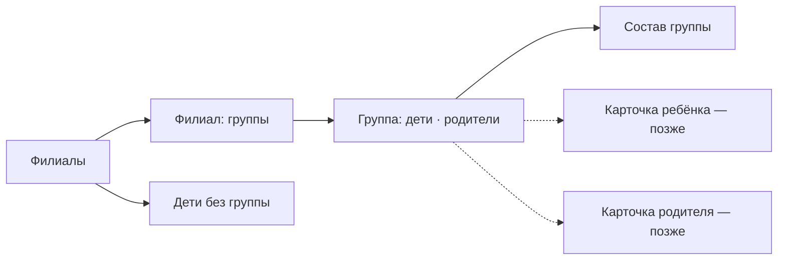

# Вкладка «Сад»: филиалы и группы

29.09.2026 · Darya Nesterova

«Сад» — вкладка администратора, где он ведёт структуру сада: филиалы, группы в них и состав групп. Остальные вкладки отвечают на другие вопросы: «Посещение» — кто сейчас в саду, «Люди» — найти конкретного человека. Здесь администратор думает группами: завести новую группу к сентябрю, наполнить её детьми, переименовать «Младшую» в «Среднюю», закрыть опустевшую группу, найти родителей детей одной группы.

**Статус: сделано 29.09.2026** — и в приложении, и на бэкенде (см. «Что сделано»). Бэкенд на стенд ещё не выложен: без него на старом сервере не работают создание, изменение и удаление групп, 409 при удалении непустого филиала и вкладка «Родители».

## Что сделано

- **Приложение** (`app/(admin)/garden/`): стек вкладки, «Филиалы» (`index.tsx`, «＋» — новый филиал, долгое нажатие — переименовать или удалить), «Филиал» (`branch/[id].tsx`), «Группа» (`group/[id].tsx`: «Дети · N» с ● и «Родители» со звонком; «⋯» — переименовать, перенести, удалить), «Дети без группы» (`without-group.tsx`), диалог названия (`name.tsx`), «Состав группы» (`group-members.tsx` — тот же экран, что в «Посещении», теперь `components/group-members-screen.tsx`).
- Данные: филиалы и группы — `state.visits.present`; изменения — slice и saga `garden` (хук `hooks/use-garden-edit.ts`: результат получает только экран, который начал изменение); дети и родители группы и «Дети без группы» — slice и saga `group-people`. После любого изменения — `refreshAfterGardenChange` (`store/sagas/garden-refresh.ts`): «Кто в саду», число детей без группы и, если открывались, «Люди» с фильтром групп.
- Меню и выбор группы или филиала — `components/option-sheet.tsx` вместо `Alert`: на Android в нём не больше трёх кнопок. На iOS действие выполняется после закрытия шторки, иначе следующий `Alert` не показывается.
- **Бэкенд:** `POST /group`, `PUT /group/{key}`, `DELETE /group/{key}` (`BRANCH_WRITE`); 409 `NAME_TAKEN` для филиалов и групп, 409 `BRANCH_NOT_EMPTY` (`groups_count`) и `GROUP_NOT_EMPTY` (`children_count`); у `GroupEntity` появился `creator`, статус снова записывается; филиал не найден — теперь 404, а не 500; `GET /user/people?category=PARENT&group_external_key=` — представители детей группы, в `children` только дети этой группы.
- Решения по ходу: переименовать можно только группу в известном филиале (сервер требует филиал вместе с названием), для группы без филиала в меню «Перенести в филиал»; перенос без подтверждения — дети остаются в группе, ничего не теряется.

## Кто видит

| Роль | Что видит |
| --- | --- |
| `ADMIN` | вкладку «Сад» целиком |
| `EMPLOYEE` | вкладку не видит (`href: null` в `app/(admin)/_layout.tsx`); группы и детей он видит в «Посещении» |
| остальные | раздела администратора нет |

Настоящая защита — права на бэкенде: филиалы и группы меняются с `BRANCH_WRITE`, состав групп — с `USER_WRITE`. У сотрудника нет ни того ни другого.

## Навигация



У вкладки свой стек (`app/(admin)/garden/_layout.tsx`), как у «Посещения» и «Заявок»: можно уйти в группу, переключиться на «Заявки» и вернуться туда же.

**Список филиалов показывается всегда, даже если филиал один.** В «Посещении» при одном филиале выбор пропускается: там важна скорость. «Сад» открывают редко, и важнее, чтобы было понятно, где добавить второй филиал. Лишнее нажатие здесь не мешает.

## Филиалы

```
┌─────────────────────────────────────┐
│  Сад                            ＋  │
│                                     │
│  ┌───────────────────────────────┐  │
│  │ Центральный                 › │  │
│  │ 4 группы · 58 детей           │  │
│  │ На Лесной                   › │  │
│  │ 2 группы · 21 ребёнок         │  │
│  │ Новый корпус                › │  │
│  │ Групп пока нет                │  │
│  └───────────────────────────────┘  │
│                                     │
│  ┌───────────────────────────────┐  │
│  │ Дети без группы           3 › │  │
│  └───────────────────────────────┘  │
└─────────────────────────────────────┘
```

- Филиалы по названию. Под названием — число групп и детей в них; у филиала без групп — «Групп пока нет».
- **«Дети без группы»** — отдельная карточка внизу, если такие дети есть. Это все активные дети без группы, а не только те, кто сейчас в саду, как в «Посещении». Чаще всего это новые дети после подтверждения заявок, их нужно распределить.
- **«Другие группы»** — строка, если у активной группы филиал удалён или не указан. Так ни одна группа не пропадёт. Это тот же приём, что в «Посещении» (`OTHER_GROUPS_ID` в `utils/presence.ts`).
- «＋» в шапке — новый филиал (диалог «Название», см. «Диалог названия»).
- Долгое нажатие на филиал или «⋯» внутри филиала — «Переименовать», «Удалить».
- Обновление — потянуть вниз и при каждом возврате на вкладку.

**Удаление филиала.** Удалить можно только филиал без групп.

- В филиале есть группы → вместо подтверждения сообщение «В филиале „Центральный“ 4 группы. Сначала удалите их или перенесите в другой филиал» и одна кнопка «Понятно».
- Пустой филиал → подтверждение «Удалить филиал „Новый корпус“?», кнопки «Отмена» и «Удалить» (destructive).
- Приложение проверяет это по своим данным. Сервер тоже должен отвечать 409, если за это время в филиал добавили группу. Сейчас сервер удаляет филиал вместе с группами, и группы остаются без филиала, см. «Что нужно на бэкенде».

**API:** `GET /branch/list` и `GET /group/presence` (все активные группы с `branch_external_key` и `total_children`), это те же данные, что в «Посещении». Число детей без группы — `GET /user/people?category=CHILD&without_group=true&size=1`, из ответа берём `totalElements`. Запись — `POST /branch`, `PUT /branch/{key}`, `DELETE /branch/{key}` (`BRANCH_WRITE`).

## Филиал: группы

```
┌─────────────────────────────────────┐
│  ‹ Сад       Центральный        ⋯   │
│                                     │
│  ┌───────────────────────────────┐  │
│  │ Ромашка                     › │  │
│  │ 18 детей · в саду 15          │  │
│  │ Солнышко                    › │  │
│  │ 15 детей · в саду 8           │  │
│  │ Новая                       › │  │
│  │ Детей пока нет                │  │
│  └───────────────────────────────┘  │
│                                     │
│  ＋ Добавить группу                 │
└─────────────────────────────────────┘
```

- Группы филиала по названию (порядок задаёт сервер, как в `/group/presence`). Пустые группы показываются: «Детей пока нет».
- «＋ Добавить группу» под списком → диалог «Название». Группа создаётся в этом филиале.
- «⋯» в шапке — «Переименовать филиал», «Удалить филиал» (правила — в разделе «Филиалы»).
- Филиал удалили, пока экран был открыт (другой администратор) → «Филиал не найден» и кнопка «К списку филиалов».

**API:** данные те же, что на экране филиалов, экран открывается без загрузки. Новая группа — `POST /group` с `branch_external_key` — **нужен бэкенд**.

## Группа

```
┌─────────────────────────────────────┐
│  ‹ Центральный   Ромашка        ⋯   │
│  ┌────────────────┬──────────────┐  │
│  │  Дети · 18   ● │   Родители   │  │
│  └────────────────┴──────────────┘  │
│  В саду 15 из 18                    │
│  ┌───────────────────────────────┐  │
│  │ ● Иванова Мария               │  │
│  │   4 года                      │  │
│  │ ○ Смирнов Пётр                │  │
│  │   5 лет                       │  │
│  │ …                             │  │
│  └───────────────────────────────┘  │
│  Изменить состав                    │
└─────────────────────────────────────┘
```

Переключатель из двух частей (`segmented-control`). Третья часть «В саду» из первой версии `docs/admin-screens.md` не нужна: это уже есть в «Посещении», а точка ● у каждого ребёнка показывает то же самое.

**Дети.**

- Все дети группы по фамилии: ● в саду / ○ нет, ФИО, возраст. Над списком — «В саду 15 из 18».
- «Изменить состав» ведёт на уже сделанный экран «Состав группы» (`group-members.tsx`, раздел «Состав группы» в `docs/admin-screens.md`). Там добавляют, переводят из другой группы и убирают детей. Убрать можно только кнопкой «Убрать» и после подтверждения. Отдельного удаления на этом экране нет: на экране просмотра удаления нет совсем, так ребёнка не убрать случайно.
- Пустая группа → «В группе пока нет детей» и кнопка «Добавить детей», она ведёт туда же.
- Нажатие на ребёнка откроет его карточку, когда она появится. До тех пор строка не нажимается.
- **API:** `GET /user/people?category=CHILD&group_external_key=…` постранично — там уже есть `present` и `birth_date`. «В саду N из M» — из `/group/presence`.

**Родители.**

```
│  Иванова Анна               📞      │
│  мама: Мария                        │
│  Иванов Сергей              📞      │
│  папа: Мария                        │
│  Смирнова Ольга             📞      │
│  бабушка: Пётр                      │
```

- Представители детей группы по фамилии. Подпись — роль связи и имя ребёнка из этой группы, как в «Людях» (`parentSubtitle`). Если у представителя двое детей в разных группах, показываем только ребёнка из этой группы.
- Кнопка звонка, как в «Людях». Это главный сценарий вкладки: воспитатель просит обзвонить родителей группы.
- **API — нужен бэкенд.** Сейчас `GET /user/people?category=PARENT&group_external_key=…` проверяет, состоит ли в группе сам родитель, и возвращает пустой список. Нужно, чтобы для `PARENT` фильтр по группе означал «представители детей этой группы», а в `children` приходили только дети этой группы.

**Меню «⋯» группы.**

| Пункт | Что происходит |
| --- | --- |
| Переименовать | диалог «Название» с текущим названием |
| Перенести в другой филиал | выбор филиала (список, как фильтр групп в «Людях»); только если филиалов больше одного. Дети остаются в группе |
| Удалить группу | только пустая группа, см. ниже |

**Удаление группы.** Только пустая группа, чтобы дети не остались без группы незаметно.

- В группе есть дети → «В группе „Ромашка“ 18 детей. Сначала переведите их в другие группы или уберите из группы» и кнопка «Изменить состав».
- Пустая → подтверждение «Удалить группу „Новая“?», кнопки «Отмена» и «Удалить» (destructive). После удаления экран возвращается к филиалу.
- Сервер тоже проверяет и отвечает 409 `GROUP_NOT_EMPTY`: за это время в группу могли добавить ребёнка. Приложение покажет то же сообщение с числом из ответа.

## Дети без группы

```
┌─────────────────────────────────────┐
│  ‹ Сад      Дети без группы         │
│  🔍 Фамилия, имя                    │
│  ┌───────────────────────────────┐  │
│  │ Орлова Вера        В группу ▾ │  │
│  │ 3 года                        │  │
│  │ Кузнецов Олег      В группу ▾ │  │
│  │ 4 года                        │  │
│  └───────────────────────────────┘  │
└─────────────────────────────────────┘
```

- Все активные дети без группы, поиск. Нужен в начале года и после подтверждения заявок: распределить новых детей, не открывая каждую группу.
- «В группу ▾» — выбор группы (по филиалам, если их несколько) → `PUT /group/{key}/children/{child_key}` без подтверждения: у ребёнка без группы ничего не теряется. После добавления строка исчезает из списка.
- Все распределены → «Все дети в группах» и возврат к филиалам.
- **API:** `GET /user/people?category=CHILD&without_group=true`, `GET /group/list`, `PUT /group/{key}/children/{child_key}` — всё уже есть.

## Диалог названия

Один компонент для филиала и группы: создать и переименовать (`components/name-dialog.tsx`). `Alert.prompt` работает только на iOS, поэтому нужен свой модальный экран с полем.

- Заголовок: «Новый филиал», «Новая группа», «Переименовать».
- Поле с автофокусом, «Сохранить» неактивна, пока поле пустое или название не изменилось. Пробелы по краям обрезаются.
- Проверки на клиенте: не пусто, до 100 символов. Название уже есть среди активных филиалов (или групп этого филиала) → «Такое название уже есть» под полем, до отправки.
- Сервер проверяет то же самое: ответ 409 `NAME_TAKEN` показывается тем же текстом, 400 `VALIDATION` — под полем.
- Пока идёт сохранение — индикатор в кнопке, повторное нажатие не отправит второй запрос: иначе появится две одинаковые группы.

## Состояния и ошибки

| Ситуация | Что видит администратор |
| --- | --- |
| Первая загрузка | индикатор по центру |
| Не загрузилось | «Не удалось загрузить данные» и «Повторить» (`LoadState`) |
| Филиалов нет | «Филиалов пока нет» и кнопка «Добавить филиал» |
| Нет сети при сохранении | «Нет соединения. Попробуйте ещё раз» в диалоге, введённое название остаётся |
| 404 при изменении (удалили на другом устройстве) | «Филиал (группа) уже удалён», список перечитывается |
| 409 при удалении | сообщение из разделов про удаление с числом групп или детей из ответа |
| 403 | «Недостаточно прав» — у администратора такого быть не должно, значит роль сменили: перечитываем `GET /user` |

## Реализация в приложении

**Маршруты:**

```
app/(admin)/garden/_layout.tsx        Stack вкладки
app/(admin)/garden/index.tsx          Филиалы
app/(admin)/garden/branch/[id].tsx    Группы филиала
app/(admin)/garden/group/[id].tsx     Группа: дети · родители
app/(admin)/garden/group-members.tsx  Состав группы (модальный)
app/(admin)/garden/without-group.tsx  Дети без группы
app/(admin)/garden/name.tsx           Диалог названия (модальный)
```

В `app/(admin)/_layout.tsx` вкладка меняется с `garden/index` на `garden` с `headerShown: false`, как у «Посещения».

**«Состав группы» в двух вкладках.** Экран уже есть в стеке «Посещения». `router.push('/visits/group-members')` из «Сада» переключил бы вкладку. Поэтому содержимое `app/(admin)/visits/group-members.tsx` переезжает в `components/group-members-screen.tsx`, а в обоих стеках остаются тонкие маршруты. Хук `useOpenGroupMembers` получает путь стека.

**Данные.**

- Филиалы и счётчики групп — `state.visits.present`, тот же `GET /group/presence` + `GET /branch/list`. Отдельный запрос не нужен, после любого изменения обе вкладки видят свежие данные. Если так станет неудобно, выносим загрузку в общий slice `garden`.
- Дети и родители группы — новый slice `groupPeople` по образцу `people`: запрос, страница, `requestId`.
- Запись (филиалы, группы) — slice и saga `garden`: `saving`, `error`, после успеха `loadPresentStart({ refresh: true })`. Состав групп — существующий `group-membership`.
- Паттерн тот же slice + saga, RTK Query не вводим (см. «Реализация в приложении» в `docs/admin-screens.md`).

## Что нужно на бэкенде

По убыванию важности:

| Доработка | Зачем |
| --- | --- |
| ~~Всё из этой таблицы~~ — сделано 29.09.2026, на стенд не выложено | — |
| `POST /group` `{ name, branch_external_key }` → `GroupDto` (`BRANCH_WRITE`). В `GroupEntity` нет поля `creator`, а в таблице `group` колонка `creator` — `NOT NULL`: без него JPA группу не сохранит | новая группа |
| `PUT /group/{key}` `{ name, branch_external_key }` — переименовать и перенести в другой филиал | переименование, перенос |
| `DELETE /group/{key}` — мягкое удаление; 409 `GROUP_NOT_EMPTY` с `children_count`, если в группе есть активные дети. У `GroupEntity.status` снять `updatable = false`, иначе статус не запишется | удаление группы |
| `DELETE /branch/{key}` → 409 `BRANCH_NOT_EMPTY` с `groups_count`, если в филиале есть активные группы | удаление филиала |
| Названия: обрезать пробелы, до 100 символов, уникальны среди активных филиалов и среди активных групп филиала без учёта регистра → 409 `NAME_TAKEN` | диалог названия |
| `GET /user/people?category=PARENT&group_external_key=` — представители детей группы, в `children` только дети этой группы | вкладка «Родители» |
| Права: группы под `BRANCH_WRITE` (структура сада, как филиалы), состав — `USER_WRITE` (уже так). Новое право `GROUP_WRITE` не вводим, пока нет роли, которой нужно одно без другого | — |

Всё остальное (`/branch/*`, `/group/presence`, `/user/people` для детей, `PUT`/`DELETE /group/{key}/children/{child_key}`) уже есть.

## Порядок работ

1. **На текущем API:** стек вкладки, филиалы со счётчиками, создание и переименование филиалов, группы филиала, экран группы с детьми, «Состав группы» в общем компоненте, «Дети без группы». Удаление филиала — с проверкой на клиенте.
2. **После API групп:** новая группа, переименование, перенос, удаление; 409 при удалении филиала.
3. **После фильтра родителей по группе:** вкладка «Родители».
4. **После карточек ребёнка и родителя** (`docs/admin-screens.md`): переходы из списков группы.

## Открытые вопросы

- **Порядок групп.** По алфавиту «Младшая, Подготовительная, Средняя, Старшая» идут не по возрасту. Нужна ли ручная сортировка (поле `position`) или достаточно называть группы «1. Младшая»?
- **Переход на новый учебный год.** Переименовывать группы («Средняя» → «Старшая») или переводить детей целой группой в другую? Второе — массовая операция, её удобнее делать в веб-админке.
- **Может ли группа быть без филиала?** В БД `branch_id` необязателен, и на экране есть «Другие группы». Предлагаю при создании требовать филиал, а старые группы без филиала показывать в «Других группах» с пунктом «Перенести в филиал».
- **Нужна ли сотруднику вкладка «Сад» только для чтения,** например чтобы воспитатель видел родителей своей группы и звонил им? Сейчас вкладка скрыта. Если нужна — открыть её без меню и «Изменить состав» и дать сотруднику доступ к списку родителей группы (сейчас `/user/people` только для `USER_WRITE`).
- **Удалять или архивировать.** Мягкое удаление скрывает группу навсегда, восстановить её из приложения нельзя. Нужно ли «Закрытые группы» с восстановлением?
