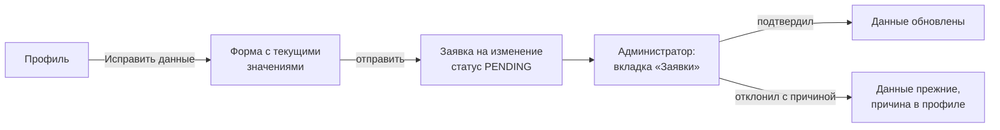
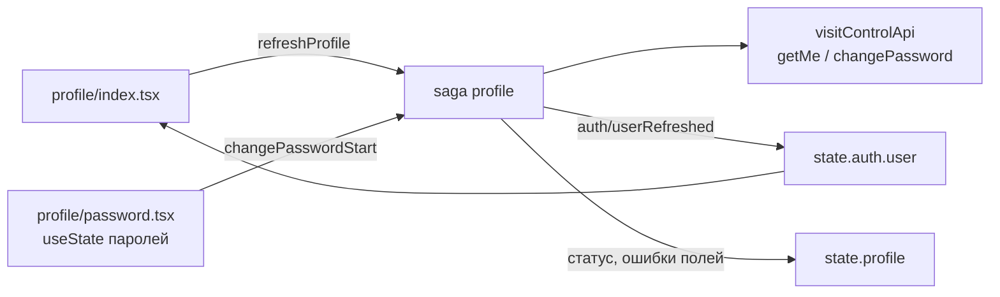

# Профиль и смена пароля

28.09.2026 · Darya Nesterova

Экран «Профиль» показывает пользователю его личные данные: ФИО, дату рождения, пол, email, телефон и роль. Экран общий для родителя и администратора.

**Главное правило: свои личные данные сам меняет только администратор.** Остальные роли (родитель, сотрудник) сами меняют только пароль. Их ФИО, дата рождения, пол, email и телефон проверены администратором при подтверждении заявки, по ним воспитатели понимают, кто забирает ребёнка. Поэтому изменение личных данных для них — это заявка, которую администратор проверяет и подтверждает, как заявку на регистрацию. Администратору проверять себя некому, и он и так может менять данные людей сада, поэтому свои данные он меняет сразу (раздел «Изменение данных администратором»).

**Статус:** просмотр профиля, смена пароля и изменение своих данных администратором реализованы (`GET /user`, `PATCH /user/password`, `PUT /user/me`); точки входа — «Ещё» у администратора и «⋯» в «Мои дети». Заявка на изменение данных для остальных ролей только проработана: для неё нужен бэкенд (см. «Заявка на изменение данных»), пока на экране подсказка «обратитесь к администратору». API сверено с кодом `visit-control-service` на 28.09.2026; `PUT /user/me` на стенд ещё не выложен.

## Мои дети

С 12.10.2026 в профиле есть раздел «Мои дети» (`visit-control-service/docs/child-requests.md`): дети, привязанные к пользователю, его заявки на добавление ребёнка и кнопка «Добавить ребёнка». Раздел есть у родителя, сотрудника, администратора и директора — сотрудники сада тоже бывают родителями; у технического администратора его нет.

- «Добавить ребёнка» открывает форму: фамилия, имя, отчество (если есть), дата рождения, пол — та же карточка, что в заявке на регистрацию.
- Администратор и директор добавляют ребёнка себе сразу. Родитель и сотрудник отправляют заявку: она видна в разделе как «Ждёт подтверждения сада», её можно отозвать. Если сад отклонил — «Сад не добавил ребёнка» ещё неделю.
- Администратор и директор решают такие заявки во вкладке «Заявки», блок «Добавление детей»: привязать ребёнка, который уже есть в саду, завести нового или не добавлять.

- Нажатие на ребёнка открывает его данные: фамилия, имя, отчество, дата рождения (пол не меняется). Администратор и директор сохраняют изменение сразу. Родитель отправляет его на подтверждение: до решения сада данные прежние, изменение можно отозвать; если сад отклонил — причина видна в карточке ещё неделю. Родственник и знакомый данные видят, но менять не могут.
- Изменения данных администратор и директор решают во вкладке «Заявки», блок «Изменение данных детей»: видно, что было и что предлагается, кнопки «Подтвердить» и «Отклонить» с причиной.

Код: `components/profile-children.tsx`, `app/profile/add-child.tsx`, `app/profile/child/[id].tsx`, `components/child-requests-list.tsx`, `components/child-changes-list.tsx`, slice и saga `child-requests`.

## Изменение данных администратором

- В профиле у администратора в шапке кнопка «Изменить» → модальный экран «Личные данные» (`app/profile/edit.tsx`). У остальных ролей кнопки нет, вместо неё подсказка «обратитесь к администратору».
- Поля: фамилия, имя, отчество с флажком «Нет отчества», дата рождения (`ДД.ММ.ГГГГ`), телефон (`+7 (XXX) XXX-XX-XX`, необязателен). Проверки — как в регистрации (`validateField`). Email показан серым с подсказкой «Email — логин для входа, здесь он не меняется»; пол не редактируется.
- «Сохранить» неактивна, пока ничего не изменено. Закрытие с изменениями — «Отменить изменения?». После сохранения экран закрывается, новые данные сразу видны в профиле, «Ещё» и «Мои дети» (`auth/userRefreshed`).
- Ошибки: 409 `PHONE_TAKEN` — «Этот номер уже привязан к другому аккаунту» под телефоном; 400 `VALIDATION` — под полями; 403 — «Менять личные данные сам может только администратор»; сеть — баннер над кнопкой.
- **Бэкенд:** `PUT /user/me` (`ProfileController`), только `USER_WRITE`. Пользователь из токена, в теле все поля целиком: `surname`, `first_name`, `patronymic`, `birth_date`, `phone`. Email и пол не меняются: email — логин и subject JWT. Свой же телефон не считается занятым.

## Как попасть в профиль

| Режим | Путь |
| --- | --- |
| Администратор | «Ещё» → карточка с именем и ролью первой строкой, над «Режимом родителя» |
| Родитель | «Мои дети» → «⋯» в шапке → «Профиль» |

Кнопка «Выйти» в шапке «Мои дети» заменена на «⋯» для всех ролей, как и планировалось в `docs/children-screen.md`. В меню у родителя: «Профиль», «Выйти», «Отмена»; у администратора: «Профиль», «Режим администратора», «Отмена». Android показывает в `Alert` не больше трёх кнопок, поэтому администратор выходит из профиля или из «Ещё».

Отдельной строки «Сменить пароль» во вкладке «Ещё» (`docs/admin-screens.md`) нет: пароль меняется из профиля, путь одинаковый в обоих режимах.

## Профиль

```
┌─────────────────────────────────┐
│ ‹ Назад        Профиль          │
│                                 │
│  ┌───────────────────────────┐  │
│  │ (МИ)  Иванова Мария       │  │
│  │       Петровна            │  │
│  │       Родитель            │  │
│  └───────────────────────────┘  │
│  ЛИЧНЫЕ ДАННЫЕ                  │
│  ┌───────────────────────────┐  │
│  │ Дата рождения  14.03.1990 │  │
│  │ Пол              Женский  │  │
│  └───────────────────────────┘  │
│  КОНТАКТЫ                       │
│  ┌───────────────────────────┐  │
│  │ Email      maria@mail.ru  │  │
│  │ Телефон +7 (912) 345-67-89│  │
│  └───────────────────────────┘  │
│  Изменить личные данные может   │
│  только администратор сада...   │
│  ┌───────────────────────────┐  │
│  │ Сменить пароль          › │  │
│  └───────────────────────────┘  │
│  ┌───────────────────────────┐  │
│  │ Выйти                     │  │
│  └───────────────────────────┘  │
└─────────────────────────────────┘
```

- Данные только для чтения, кроме администратора: у него в шапке «Изменить» (раздел «Изменение данных администратором»).
- Шапка: круг с инициалами (фото в API нет), полное ФИО, роль словом: «Родитель», «Сотрудник», «Администратор».
- Карточки в стиле вкладки «Ещё»: белые, `borderRadius: 10`, тень. Пустые поля (нет телефона, отчества) не показываются.
- У родителя и сотрудника под контактами подсказка: «Изменить личные данные может только администратор сада после проверки. Если что-то указано неверно, обратитесь к нему». Когда появится заявка на изменение, подсказку заменит кнопка «Исправить данные». У администратора подсказки нет.
- Данные сразу берутся из `state.auth.user`, а при каждом открытии экрана в фоне перечитываются через `GET /user`: администратор мог подтвердить изменение, пока приложение было открыто. Ошибка фонового обновления не показывается — на экране остаются данные с момента входа. Pull-to-refresh тоже перечитывает.
- «Выйти» — тот же диалог, что в «Ещё».

## Оформление: светлая и тёмная тема

- Раздел «ОФОРМЛЕНИЕ» над «Выйти»: переключатель «Системная / Светлая / Тёмная». Под ним подсказка: для системной — «Светлая или тёмная — как в настройках телефона», иначе — «Выбор сохраняется на этом устройстве».
- Тема — настройка устройства, а не аккаунта: хранится в AsyncStorage (`visit-control.theme.v1`), переживает выход и смену пользователя, на сервер не уходит. Экран общий для всех ролей, поэтому выбор есть и у родителя, и у персонала.
- Все экраны получают выбранную тему через общий `useColorScheme`: явный выбор имеет приоритет над системным. В нативном приложении дополнительно вызывается `Appearance.setColorScheme`, чтобы менять системные диалоги, клавиатуру и статус-бар; «Системная» сбрасывает переопределение через `null`.
- В PWA у `Appearance` нет `setColorScheme`: переключение работает через подписку на настройку. Фон документа, `color-scheme` и `theme-color` синхронизируются с темой приложения, даже если тема телефона другая.
- При запуске выбор читается в `app/_layout.tsx`. До чтения настройки используется системная тема; при первоначальном веб-рендеринге — светлая, чтобы избежать расхождения разметки при гидратации.
- Цвета всех экранов — из палитры `constants/palette.ts` (светлая и тёмная), стили — через `makeStyles`, см. «Стилизация» в `memory-bank/systemPatterns.md`. Шапки и таб-бар получают те же цвета через тему навигации. Заставка, скрывающая данные при сворачивании, в обеих темах одинаково тёмная.

## Смена пароля

```
┌─────────────────────────────────┐
│ ‹ Профиль    Смена пароля       │
│                                 │
│ Текущий пароль                  │
│ [••••••••                  👁 ] │
│ Новый пароль                    │
│ [••••••••••                👁 ] │
│ Не меньше 8 символов            │
│ Повторите новый пароль          │
│ [••••••••••                👁 ] │
│                                 │
│ [       Сменить пароль       ]  │
│                                 │
│ После смены вход на этом        │
│ устройстве сохранится           │
└─────────────────────────────────┘
```

| Поле | Проверка на клиенте | Ввод |
| --- | --- | --- |
| Текущий пароль | заполнено | `autoComplete="current-password"`, `textContentType="password"` |
| Новый пароль | 8–72 **байта** в UTF-8 и не совпадает с текущим | `autoComplete="new-password"`, `textContentType="newPassword"`: iOS предложит надёжный пароль и сохранит его в Связку ключей |
| Повторите | совпадает с новым | то же |

- Кнопка «глаз» в поле показывает пароль. Автоисправление и автозаглавные выключены.
- Ограничение в байтах, а не символах: bcrypt учитывает только первые 72 байта. Пароль из 40 кириллических букв — 80 байт, хвост просто отбросится. Бэкенд сейчас проверяет `@Size(max = 72)` по символам.
- Проверка поля при потере фокуса, всей формы — по кнопке. Кнопка блокируется до ответа, двойной тап не шлёт второй запрос.
- После успеха `Alert` «Пароль изменён» и возврат в профиль. Токен остаётся действительным, PIN и биометрия не меняются: входить заново не нужно.
- Пароли не попадают в Redux state и в логи. Поля живут в `useState` экрана и пропадают при уходе с него.

**Ошибки**

| Ответ | Что показываем |
| --- | --- |
| 400 без кода (так бэкенд отвечает на `BadCredentialsException`) | «Неверный текущий пароль» под первым полем |
| 400 `VALIDATION` с `errors.new_password` | «Пароль должен быть от 8 до 72 символов» под полем «Новый пароль» |
| 401 | общий выход по 401, как везде |
| Нет ответа (сеть, таймаут) | «Сервер не ответил, и пароль мог уже смениться. Если при повторе текущий пароль не подойдёт, введите в это поле новый». Запрос мог дойти, а повтор со старым текущим паролем вернёт «Неверный текущий пароль». Автоповторов нет |
| 5xx и прочее | «Не удалось сменить пароль. Попробуйте позже» |

## Заявка на изменение данных

Пока не реализовано, нужен бэкенд. Проработано, чтобы экран профиля сейчас не противоречил будущему сценарию.



**Пользователь**

- В профиле кнопка «Исправить данные» → форма с теми же полями и правилами, что в регистрации: ФИО (с флажком «Нет отчества»), дата рождения, пол, телефон. Email в форме не меняется: он логин и `subject` JWT, его смена — отдельный сценарий с подтверждением письмом.
- Отправляются только изменённые поля. Кнопка «Отправить на проверку» неактивна, пока ничего не изменено.
- Пока заявка на проверке, в профиле плашка «Изменения на проверке у администратора: фамилия, телефон» и «Отозвать заявку». Одновременно может быть только одна заявка; новая заменяет прежнюю.
- Отказ показывается в профиле с причиной от администратора, пока пользователь его не закроет.
- До подтверждения везде показываются старые данные.

**Администратор**

- Заявки на изменение — во вкладке «Заявки» рядом с заявками на регистрацию, с отметкой «Изменение данных» и тем же значком-счётчиком.
- Карточка заявки показывает «было → стало» только по изменённым полям.
- «Подтвердить» и «Отклонить» с причиной — как у заявок на регистрацию. После подтверждения сервер применяет изменения одной транзакцией.
- Администратор меняет свои данные тоже через заявку. Подтвердить её может другой администратор; если он в саду один, свою заявку подтверждает сам — это решение за владельцем продукта.

**Что нужно на бэкенде**

| Доработка | Зачем |
| --- | --- |
| Сущность «заявка на изменение данных»: пользователь, изменённые поля, статус (`PENDING`, `APPROVED`, `REJECTED`, `WITHDRAWN`), причина отказа, кто и когда решил | хранить заявки и историю |
| `POST /user/me/change-request` (`isAuthenticated()`, пользователь из токена, в теле только разрешённые поля), `GET /user/me/change-request` — текущая заявка, `DELETE` — отозвать | сторона пользователя |
| `GET /user/change-request/list`, `POST /user/change-request/{key}/approve` и `/reject` (`USER_WRITE`) | сторона администратора |
| 409 `PHONE_TAKEN` при подаче и при подтверждении | телефон уникален |
| Существующий `PUT /user` не открывать для пользователей: он принимает `role` и `external_key` в теле | иначе можно поменять себе роль |

## Реализация в приложении

**Маршруты.** Профиль открывается поверх вкладок администратора и поверх «Мои дети», поэтому лежит в корне, а не в `(admin)`. Оба экрана — внутри `Stack.Protected guard={protectedRoutes}` в `components/session/session-gate.tsx`.

```
app/profile/index.tsx      Профиль
app/profile/password.tsx   Смена пароля
```

**Данные.** Профиль хранится в `state.auth.user`, копии в отдельном slice нет: иначе «Ещё», «Мои дети» и профиль показывали бы разные версии имени. Slice `profile` хранит только статусы запросов.



| Файл | Что там |
| --- | --- |
| `store/types/auth.ts` | в `User` добавлены `birthDate` (ISO `YYYY-MM-DD`) и `phone` |
| `store/types/profile.ts` | `ProfileState`, поля и ошибки формы пароля |
| `store/reducers/auth.ts` | `userRefreshed(User)` — заменяет пользователя, только если сессия та же и `id` совпадает |
| `store/reducers/profile.ts` | `refreshProfile`, `refreshProfileDone`; `changePasswordStart/Success/Failure`, `clearPasswordFieldError`, `resetPasswordChange` |
| `store/sagas/profile.ts` | `takeLatest` для обновления, `takeLeading` для смены пароля; результат прошлой сессии отбрасывается по `sessionEpoch`, как в `visits.ts`; `toChangePasswordFailure` переводит ошибку API в ошибки формы |
| `store/devtools.ts` | `profile/changePasswordStart` в `SECRET_ACTION_TYPES`: Redux DevTools видят `[REDACTED]` |
| `services/api/visit-control-api.ts` | `birth_date` и `phone` в `UserDto`; `changePassword` — `skipLogging`, без ретраев |
| `utils/password-validation.ts` | проверки формы пароля, `utf8Length` |
| `utils/profile-format.ts` | ФИО, инициалы, роль, пол, дата и телефон для отображения |
| `components/form-field.tsx` | проп `accessory` — элемент справа в поле ввода |
| `components/password-field.tsx` | поле пароля с кнопкой «показать» |
| `components/profile-summary.tsx` | инициалы, ФИО, роль — в профиле и в «Ещё» |
| `app/profile/edit.tsx` | изменение своих данных администратором, `presentation: 'modal'` |
| `utils/profile-edit.ts` | форма из профиля, проверки (как в регистрации, телефон необязателен), тело `PUT /user/me` |
| `store/reducers/profile.ts`, `store/sagas/profile.ts` | `saveProfileStart/Success/Failure` (`takeLeading`), `toSaveProfileFailure`; после успеха `auth/userRefreshed` |

## Открытые вопросы

- ~~Кто подтверждает заявку на изменение данных, если администратор в саду один и меняет свои данные?~~ — администратор меняет свои данные сам, без заявки (28.09.2026).
- Нужен ли в профиле «Удалить аккаунт» (отзыв согласия на обработку ПДн, `POST /user/consent/withdraw` — уже есть)? По 152-ФЗ отзыв согласия должен быть доступен. Если да — последней строкой, красным, с подтверждением «Войти снова будет нельзя».
- Нужна ли смена email самим пользователем с подтверждением письмом, или это только через администратора?
- Флаг `password_change_required` в `UserDto` для обязательной смены стартового пароля при первом входе (`docs/registration-screen.md`): экран смены пароля готов для этого, но без кнопки «Назад».
