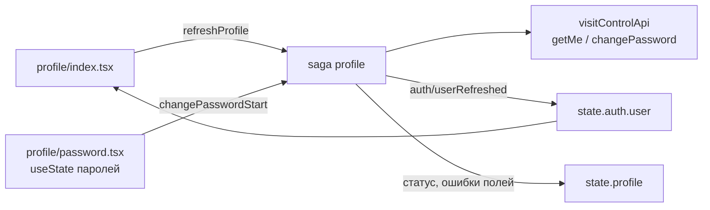

# Профиль и смена пароля

28.09.2026 · Darya Nesterova

Экран «Профиль» показывает пользователю его личные данные: ФИО, дату рождения, пол, email, телефон и роль. Экран общий для всех ролей.

С релиза 1.0.3 все роли самостоятельно меняют свои ФИО, дату рождения, пол и телефон. Изменения сохраняются сразу, без заявки и подтверждения. Email остаётся логином. Просмотр профиля, изменение данных и смена пароля используют `GET /user`, `PUT /user/me`, `PATCH /user/password`.

## Мои дети

С 12.10.2026 в профиле есть раздел «Мои дети» (`visit-control-service/docs/child-requests.md`): дети, привязанные к пользователю, его заявки на добавление ребёнка и кнопка «Добавить ребёнка». Раздел есть у родителя, сотрудника, администратора и директора — сотрудники сада тоже бывают родителями; у технического администратора его нет.

- «Добавить ребёнка» открывает форму: фамилия, имя, отчество (если есть), дата рождения, пол — та же карточка, что в заявке на регистрацию.
- Администратор и директор добавляют ребёнка себе сразу. Родитель и сотрудник отправляют заявку: она видна в разделе как «Ждёт подтверждения сада», её можно отозвать. Если сад отклонил — «Сад не добавил ребёнка» ещё неделю.
- Администратор и директор решают такие заявки во вкладке «Заявки», блок «Добавление детей»: привязать ребёнка, который уже есть в саду, завести нового или не добавлять.

- Нажатие на ребёнка открывает его данные: фамилия, имя, отчество, дата рождения (пол не меняется). Администратор и директор сохраняют изменение сразу. Родитель отправляет его на подтверждение: до решения сада данные прежние, изменение можно отозвать; если сад отклонил — причина видна в карточке ещё неделю. Родственник и знакомый данные видят, но менять не могут.
- Изменения данных администратор и директор решают во вкладке «Заявки», блок «Изменение данных детей»: видно, что было и что предлагается, кнопки «Подтвердить» и «Отклонить» с причиной.

Код: `components/profile-children.tsx`, `app/profile/add-child.tsx`, `app/profile/child/[id].tsx`, `components/child-requests-list.tsx`, `components/child-changes-list.tsx`, slice и saga `child-requests`.

## Самостоятельное изменение данных

- Кнопка «Изменить» в шапке есть у родителя, сотрудника, администратора, директора и технического администратора. Она открывает модальный экран «Личные данные» (`app/profile/edit.tsx`).
- Поля: фамилия, имя, отчество с флажком «Нет отчества», дата рождения (`ДД.ММ.ГГГГ`), пол, телефон (`+7 (XXX) XXX-XX-XX`, необязателен). Проверки — как в регистрации; возраст от 16 до 100 лет. Email показан для справки с подсказкой «Email — логин для входа, здесь он не меняется».
- «Сохранить» неактивна, пока ничего не изменено. Во время запроса поля и кнопка блокируются. После успешного ответа форма закрывается, новые данные сразу видны в профиле, «Ещё» и «Мои дети» через `auth/userRefreshed`; входить заново не нужно.
- При уходе из несохранённой формы остаётся вопрос «Отменить изменения?». Перед сохранением дополнительного подтверждения нет.
- `409 PHONE_TAKEN` показывает «Этот номер уже привязан к другому аккаунту» под телефоном; `400 VALIDATION` относится к полям. Ошибка не закрывает форму и не стирает ввод. При отсутствии ответа: «Не удалось получить ответ сервера. Изменения могли сохраниться — проверьте соединение и обновите профиль». Автоповтора записи нет.
- `PUT /user/me` доступен авторизованному пользователю; адресат определяется только по токену. Тело: `surname`, `first_name`, `patronymic`, `birth_date`, `gender`, `phone`. Email, роль, сад, статус, пароль и связи с детьми не меняются. Старое тело без `gender` сохраняет прежний пол; собственный телефон не считается занятым.

## Как попасть в профиль

| Режим | Путь |
| --- | --- |
| Администратор | «Ещё» → карточка с именем и ролью первой строкой, над «Режимом родителя» |
| Родитель | «Мои дети» → «⋯» в шапке → «Профиль» |

Кнопка «Выйти» в шапке «Мои дети» заменена на «⋯» для всех ролей, как и планировалось в `docs/children-screen.md`. В меню у родителя: «Профиль», «Выйти», «Отмена»; у администратора: «Профиль», «Режим администратора», «Отмена». Android показывает в `Alert` не больше трёх кнопок, поэтому администратор выходит из профиля или из «Ещё».

Отдельной строки «Сменить пароль» во вкладке «Ещё» (`docs/admin-screens.md`) нет: пароль меняется из профиля, путь одинаковый в обоих режимах.

## Профиль

```
┌─────────────────────────────────┐
│ ‹ Назад  Профиль      Изменить  │
│                                 │
│  ┌───────────────────────────┐  │
│  │ (МИ)  Иванова Мария       │  │
│  │       Петровна            │  │
│  │       Родитель            │  │
│  └───────────────────────────┘  │
│  ЛИЧНЫЕ ДАННЫЕ                  │
│  ┌───────────────────────────┐  │
│  │ Дата рождения  14.03.1990 │  │
│  │ Пол              Женский  │  │
│  └───────────────────────────┘  │
│  КОНТАКТЫ                       │
│  ┌───────────────────────────┐  │
│  │ Email      maria@mail.ru  │  │
│  │ Телефон +7 (912) 345-67-89│  │
│  └───────────────────────────┘  │
│  ┌───────────────────────────┐  │
│  │ Сменить пароль          › │  │
│  └───────────────────────────┘  │
│  ┌───────────────────────────┐  │
│  │ Выйти                     │  │
│  └───────────────────────────┘  │
└─────────────────────────────────┘
```

- Все роли открывают форму по кнопке «Изменить» в шапке; сам экран профиля показывает сохранённые данные.
- Шапка: круг с инициалами (фотографию показывает PhotoEditor), полное ФИО, роль словом: «Родитель», «Сотрудник», «Администратор».
- Карточки в стиле вкладки «Ещё»: белые, `borderRadius: 10`, тень. Пустые поля (нет телефона, отчества) не показываются.
- Данные сразу берутся из `state.auth.user`, а при каждом открытии экрана в фоне перечитываются через `GET /user`: данные могли измениться с другого устройства. Ошибка фонового обновления не показывается — на экране остаются данные с момента входа. Pull-to-refresh тоже перечитывает.
- «Выйти» — тот же диалог, что в «Ещё».

## Оформление: светлая и тёмная тема

- Раздел «ОФОРМЛЕНИЕ» над «Выйти»: переключатель «Системная / Светлая / Тёмная». Под ним подсказка: для системной — «Светлая или тёмная — как в настройках телефона», иначе — «Выбор сохраняется на этом устройстве».
- Тема — настройка устройства, а не аккаунта: хранится в AsyncStorage (`visit-control.theme.v1`), переживает выход и смену пользователя, на сервер не уходит. Экран общий для всех ролей, поэтому выбор есть и у родителя, и у персонала.
- Все экраны получают выбранную тему через общий `useColorScheme`: явный выбор имеет приоритет над системным. В нативном приложении дополнительно вызывается `Appearance.setColorScheme`, чтобы менять системные диалоги, клавиатуру и статус-бар; «Системная» сбрасывает переопределение через `null`.
- В PWA у `Appearance` нет `setColorScheme`: переключение работает через подписку на настройку. Фон документа, `color-scheme` и `theme-color` синхронизируются с темой приложения, даже если тема телефона другая.
- При запуске выбор читается в `app/_layout.tsx`. До чтения настройки используется системная тема; при первоначальном веб-рендеринге — светлая, чтобы избежать расхождения разметки при гидратации.
- Цвета всех экранов — из палитры `constants/palette.ts` (светлая и тёмная), стили — через `makeStyles`, см. «Стилизация» в `memory-bank/systemPatterns.md`. Шапки и таб-бар получают те же цвета через тему навигации. Заставка, скрывающая данные при сворачивании, в обеих темах одинаково тёмная.

## Версия приложения

С релиза 1.0.2 под «Выйти» у всех ролей есть спокойная текстовая строка, которую можно выделить и скопировать для поддержки.

- В установленном МП: «Версия 1.0.2 · сборка 3». `expo-application` читает версию и номер сборки установленного Android/iOS приложения, поэтому обновление JavaScript не подменяет сведения о бинарном файле. Если номер сборки отсутствует, показывается только версия.
- В PWA: «Версия 1.0.2». Источник — `Constants.expoConfig.version`, включённый в загруженный клиент при сборке. Запросов к серверу и отдельного хранения версии нет: старый открытый клиент продолжает показывать свою версию до обновления.
- В Expo Go показывается версия проекта без номера сборки приложения Expo Go. Если нужных сведений нет, строка сообщает «Версия недоступна».

Версия релиза задаётся в `app.json` (`expo.version`) и синхронизируется с `package.json`; локальные native-сборки используют `android.versionCode` / `ios.buildNumber`. При EAS-сборках с `appVersionSource: remote` счётчик сборки задаёт EAS — профиль показывает фактическое значение установленного приложения.

`npm run build:web` очищает кэш Metro перед экспортом: встроенный публичный конфиг Expo не должен сохранять версию от предыдущей сборки.

## Смена пароля

```
┌─────────────────────────────────┐
│ ‹ Профиль    Смена пароля       │
│                                 │
│ Текущий пароль                  │
│ [••••••••                  👁 ] │
│ Новый пароль                    │
│ [••••••••••                👁 ] │
│ Не меньше 8 символов            │
│ Повторите новый пароль          │
│ [••••••••••                👁 ] │
│                                 │
│ [       Сменить пароль       ]  │
│                                 │
│ После смены вход на этом        │
│ устройстве сохранится           │
└─────────────────────────────────┘
```

| Поле | Проверка на клиенте | Ввод |
| --- | --- | --- |
| Текущий пароль | заполнено | `autoComplete="current-password"`, `textContentType="password"` |
| Новый пароль | 8–72 **байта** в UTF-8 и не совпадает с текущим | `autoComplete="new-password"`, `textContentType="newPassword"`: iOS предложит надёжный пароль и сохранит его в Связку ключей |
| Повторите | совпадает с новым | то же |

- Кнопка «глаз» в поле показывает пароль. Автоисправление и автозаглавные выключены.
- Ограничение в байтах, а не символах: bcrypt учитывает только первые 72 байта. Пароль из 40 кириллических букв — 80 байт, хвост просто отбросится. Бэкенд сейчас проверяет `@Size(max = 72)` по символам.
- Проверка поля при потере фокуса, всей формы — по кнопке. Кнопка блокируется до ответа, двойной тап не шлёт второй запрос.
- После успеха `Alert` «Пароль изменён» и возврат в профиль. Токен остаётся действительным, PIN и биометрия не меняются: входить заново не нужно.
- Пароли не попадают в Redux state и в логи. Поля живут в `useState` экрана и пропадают при уходе с него.

**Ошибки**

| Ответ | Что показываем |
| --- | --- |
| 400 без кода (так бэкенд отвечает на `BadCredentialsException`) | «Неверный текущий пароль» под первым полем |
| 400 `VALIDATION` с `errors.new_password` | «Пароль должен быть от 8 до 72 символов» под полем «Новый пароль» |
| 401 | общий выход по 401, как везде |
| Нет ответа (сеть, таймаут) | «Сервер не ответил, и пароль мог уже смениться. Если при повторе текущий пароль не подойдёт, введите в это поле новый». Запрос мог дойти, а повтор со старым текущим паролем вернёт «Неверный текущий пароль». Автоповторов нет |
| 5xx и прочее | «Не удалось сменить пароль. Попробуйте позже» |

## Реализация в приложении

**Маршруты.** Профиль открывается поверх вкладок администратора и поверх «Мои дети», поэтому лежит в корне, а не в `(admin)`. Оба экрана — внутри `Stack.Protected guard={protectedRoutes}` в `components/session/session-gate.tsx`.

```
app/profile/index.tsx      Профиль
app/profile/password.tsx   Смена пароля
```

**Данные.** Профиль хранится в `state.auth.user`, копии в отдельном slice нет: иначе «Ещё», «Мои дети» и профиль показывали бы разные версии имени. Slice `profile` хранит только статусы запросов.



| Файл | Что там |
| --- | --- |
| `store/types/auth.ts` | в `User` добавлены `birthDate` (ISO `YYYY-MM-DD`) и `phone` |
| `store/types/profile.ts` | `ProfileState`, поля и ошибки формы пароля |
| `store/reducers/auth.ts` | `userRefreshed(User)` — заменяет пользователя, только если сессия та же и `id` совпадает |
| `store/reducers/profile.ts` | `refreshProfile`, `refreshProfileDone`; `changePasswordStart/Success/Failure`, `clearPasswordFieldError`, `resetPasswordChange` |
| `store/sagas/profile.ts` | `takeLatest` для обновления, `takeLeading` для смены пароля; результат прошлой сессии отбрасывается по `sessionEpoch`, как в `visits.ts`; `toChangePasswordFailure` переводит ошибку API в ошибки формы |
| `store/devtools.ts` | `profile/changePasswordStart` в `SECRET_ACTION_TYPES`: Redux DevTools видят `[REDACTED]` |
| `services/api/visit-control-api.ts` | `birth_date` и `phone` в `UserDto`; `changePassword` — `skipLogging`, без ретраев |
| `utils/password-validation.ts` | проверки формы пароля, `utf8Length` |
| `utils/profile-format.ts` | ФИО, инициалы, роль, пол, дата и телефон для отображения |
| `components/form-field.tsx` | проп `accessory` — элемент справа в поле ввода |
| `components/password-field.tsx` | поле пароля с кнопкой «показать» |
| `components/profile-summary.tsx` | инициалы, ФИО, роль — в профиле и в «Ещё» |
| `app/profile/edit.tsx` | изменение своих данных всеми ролями, `presentation: 'modal'` |
| `utils/profile-edit.ts` | форма из профиля, проверки (как в регистрации, телефон необязателен), тело `PUT /user/me` |
| `store/reducers/profile.ts`, `store/sagas/profile.ts` | `saveProfileStart/Success/Failure` (`takeLeading`), `toSaveProfileFailure`; после успеха `auth/userRefreshed` |

## Открытые вопросы

- Нужен ли в профиле «Удалить аккаунт» (отзыв согласия на обработку ПДн, `POST /user/consent/withdraw` — уже есть)? По 152-ФЗ отзыв согласия должен быть доступен. Если да — последней строкой, красным, с подтверждением «Войти снова будет нельзя».
- Нужна ли смена email самим пользователем с подтверждением письмом, или это только через администратора?
- Флаг `password_change_required` в `UserDto` для обязательной смены стартового пароля при первом входе (`docs/registration-screen.md`): экран смены пароля готов для этого, но без кнопки «Назад».
