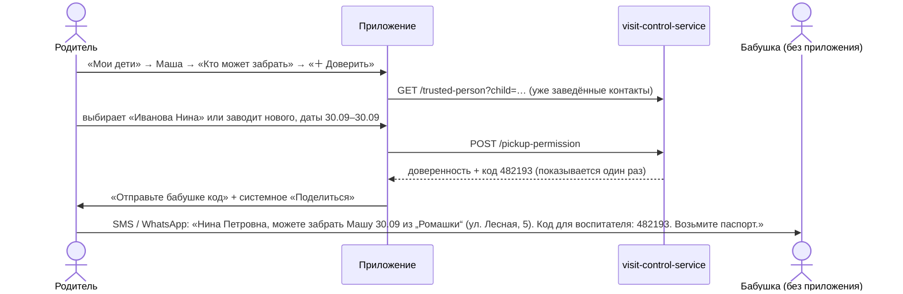
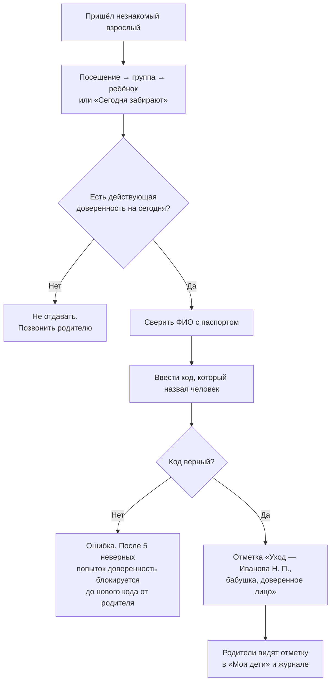
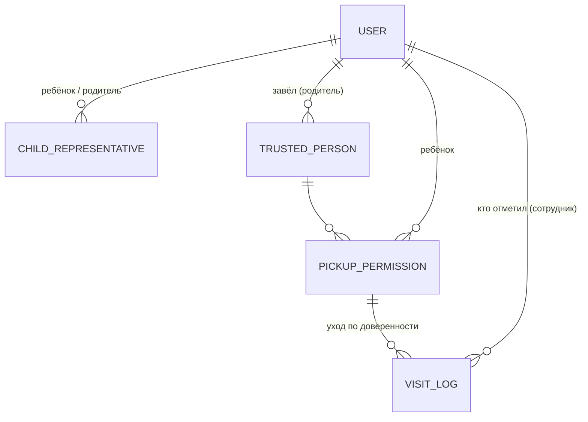

# Доверенные лица: кто ещё может забрать ребёнка

29.09.2026 · Darya Nesterova

Иногда ребёнка забирает не родитель, а бабушка, дядя, соседка или няня. Обычно у такого человека нет аккаунта в приложении, а воспитатель его не знает. Сейчас родители предупреждают устно или в мессенджере, и воспитатель отдаёт ребёнка «со слов». Здесь описано, как родитель в приложении доверяет забрать ребёнка конкретному человеку: на один день или на период до месяца. Родитель может в любой момент отозвать доверие. Воспитатель видит, кому сегодня можно отдать ребёнка, и проверяет этого человека.

**Статус: только проработано.** Кода нет. Нужна доработка и приложения, и бэкенда, см. «API» и «Порядок работ». Модель данных сверена с `visit-control-service` на 29.09.2026. До начала работ нужно закрыть две дыры в правах, см. «Что нужно исправить до начала».

## Главные решения

1. **Доверенному лицу не нужен аккаунт.** Бабушка на один раз не будет ставить приложение, регистрироваться и ждать подтверждения администратора. Её заводит родитель: ФИО, телефон и кем она приходится ребёнку. Это **контакт**, а не пользователь. Войти в приложение он не может.
2. **Два уровня: контакт и доверенность.** Контакт — это человек («Иванова Нина Петровна, бабушка»). Доверенность — разрешение забрать конкретного ребёнка в конкретные дни: «30.09», «с 01.10 по 31.10». У контакта бывает несколько доверенностей, прошлые остаются в истории. Бабушку не нужно заводить заново каждый раз: родитель выбирает её из списка и указывает новые даты.
3. **Отдаёт ребёнка сотрудник, а не приложение доверенного лица.** Раз у доверенного лица нет приложения, уход отмечает воспитатель или администратор со своего телефона. Он видит список «Сегодня могут забрать» и проверяет человека двумя способами:
   - **Код.** Родитель пересылает доверенному лицу шестизначный код, тот называет его воспитателю. Код защищает от человека, который просто знает, как зовут бабушку.
   - **Документ.** ФИО в паспорте должно совпасть с доверенностью. Документ защищает от человека, который подсмотрел код.
4. **Доверие меняют только родители ребёнка.** Выдать и отозвать доверенность может представитель со связью `PARENT`. Второй родитель видит все доверенности и может отозвать доверенность, выданную первым. Родственники и знакомые со своим аккаунтом (`RELATIVE`, `ACQUAINTANCE`) сами никого доверенным лицом не назначают.
5. **Срок — от одного дня до 31 дня.** Для «бабушка забирает всегда» доверенность не подходит. Такого человека администратор заводит постоянным представителем (`RELATIVE`) с аккаунтом, как сейчас. Раздел «Когда нужен постоянный представитель».
6. **Отзыв срабатывает сразу.** Отозванную доверенность воспитатель видит перечёркнутой, код перестаёт подходить. Возобновить отозванную доверенность нельзя, можно выдать новую.

## Роли и что каждый видит

| Кто | Что может |
| --- | --- |
| Родитель (`PARENT` в связи с ребёнком) | заводить контакты, выдавать и отзывать доверенности для своих детей, видеть историю, отправлять код заново |
| Другой представитель со своим аккаунтом (`RELATIVE`, `ACQUAINTANCE`) | видит, кто сегодня может забрать ребёнка; выдавать и отзывать не может |
| Воспитатель (`EMPLOYEE`) | видит действующие доверенности на сегодня, отмечает уход ребёнка с доверенным лицом после проверки кода и документа |
| Администратор (`ADMIN`) | то же, что воспитатель, плюс видит все доверенности ребёнка в карточке и может отозвать любую (например, по звонку родителя) |
| Доверенное лицо | аккаунта нет. Получает от родителя сообщение с датами, адресом и кодом |

## Сценарии

### Родитель доверяет забрать ребёнка



1. «Мои дети» → меню «⋯» на карточке ребёнка → **«Кто может забрать»**. На экране сверху родители и постоянные представители (только чтение), ниже доверенные лица с доверенностями.
2. «＋ Доверить забрать» → шаг «Кто»: список уже заведённых контактов семьи и «Новый человек».
3. Новый человек: фамилия, имя, отчество (необязательно), телефон, «Кем приходится» (бабушка, дедушка, тётя, дядя, брат или сестра, няня, знакомый, другое — со своим текстом). Галочка «Человек согласен, что его данные передаются в детский сад»: без неё сохранить нельзя (раздел «Персональные данные»).
4. Шаг «Когда»: «Сегодня», «Завтра» или «Период» (календарь «с — по», не больше 31 дня, начиная с сегодня). Комментарий для воспитателя — необязательно: «заберёт в 15:00, после бассейна».
5. Детей в семье несколько — галочки «Маша», «Петя» (по умолчанию — ребёнок, с чьей карточки пришли). Одна доверенность на каждого ребёнка, код общий.
6. «Доверить» → экран с кодом крупно и кнопкой **«Отправить Нине Петровне»**: системное «Поделиться» с готовым текстом (имя ребёнка, даты, сад и адрес филиала, код, «возьмите паспорт»). Код показывается один раз. Если родитель его потерял — «Новый код» (старый перестаёт работать).
7. Второй родитель видит новую доверенность у себя на экране «Кто может забрать» с подписью «доверила Анна».

### Родитель отзывает доверие

- На экране «Кто может забрать» у действующей доверенности кнопка **«Отозвать»** → подтверждение «Отозвать доверенность? Нина Петровна больше не сможет забрать Машу 30.09. Код перестанет работать» → «Отозвать» (destructive). Сразу после этого доверенность «Отозвана 29.09 в 14:05, Анна».
- Отозвать можно только действующую или будущую доверенность. Истёкшая остаётся в истории как есть.
- «Удалить человека» в карточке контакта отзывает все его доверенности и скрывает контакт из списка семьи. ФИО остаётся только в истории отметок: в журнале за прошлые дни должно быть видно, кто забрал.
- Отзыв не отменяет уже сделанную отметку: если бабушка уже забрала ребёнка, в журнале это остаётся.
- Если бабушка уже едет, родителю стоит ей позвонить. Приложение подсказывает это в тексте подтверждения, когда доверенность действует сегодня.

### Воспитатель отдаёт ребёнка



- В «Посещении» у ребёнка, у которого есть действующая на сегодня доверенность, значок «доверенное лицо». В начале экрана «Кто в саду» блок **«Сегодня забирают доверенные лица · 3»**. Нажатие открывает список: ребёнок, группа, кто забирает, кем приходится, телефон, комментарий родителя.
- Нажатие на строку → карточка доверенности: ФИО крупно («сверьте с паспортом»), даты, кто доверил, телефоны доверенного лица и родителей (кнопки звонка), поле **«Код от доверенного лица»** и кнопка **«Отдать ребёнка»**. Кнопка активна только после ввода шести цифр.
- Код верный → отметка ухода от имени доверенного лица, ребёнок уходит из «в саду». Код неверный → «Код не подходит. Осталось попыток: 4». После пятой неверной попытки доверенность блокируется: «Слишком много неверных кодов. Попросите родителя прислать новый код». Родитель получает новый код кнопкой «Новый код».
- Нет кода, но воспитатель дозвонился до родителя и тот подтверждает — **«Отдать без кода»** с обязательной причиной («родитель подтвердил по телефону»). Отметка помечается, причина видна родителям и администратору. Без этого варианта люди будут диктовать коды по телефону, и защита потеряет смысл. Но воспитателю нужен законный выход.
- Утром доверенное лицо может и привести ребёнка. Приход отмечает воспитатель той же кнопкой, код не нужен: привести ребёнка — не риск.

### Что видят родители после

- В «Мои дети» на карточке: «Не в саду · забрала Иванова Н. П. (бабушка) в 17:30». Push-уведомлений пока нет. Когда появятся, это первое событие, о котором стоит сообщать.
- В «Журнале» администратора: «Уход — Иванова Н. П. (бабушка, доверенное лицо; отметила Смирнова О.)». Без кода — ещё и причина.

## Макеты

```
Кто может забрать Машу                 ＋ Доверить
┌─────────────────────────────────────┐
│ ПОСТОЯННО                           │
│  Иванова Анна · мама                │
│  Иванов Сергей · папа               │
│                                     │
│ ДОВЕРЕННЫЕ ЛИЦА                     │
│  Иванова Нина Петровна · бабушка    │
│  ● Сегодня, 30 сентября             │
│    доверила Анна · «после бассейна» │
│    [ Новый код ]      [ Отозвать ]  │
│  ─────────────────────────────────  │
│  Петров Игорь · дядя                │
│  ○ 6–10 октября · ещё не началась   │
│    [ Новый код ]      [ Отозвать ]  │
│  ─────────────────────────────────  │
│  Соседка Ольга · знакомая           │
│  Истекла 12 сентября          ›     │
└─────────────────────────────────────┘
```

```
Доверить забрать                 шаг 2 из 2
┌─────────────────────────────────────┐
│ Иванова Нина Петровна · бабушка     │
│                                     │
│ Когда                               │
│ ┌────────┬────────┬───────────────┐ │
│ │Сегодня │ Завтра │   Период ●    │ │
│ └────────┴────────┴───────────────┘ │
│  с 01.10.2026   по 31.10.2026       │
│                                     │
│ Детей                               │
│  ☑ Маша    ☐ Петя                   │
│                                     │
│ Комментарий для воспитателя         │
│ [ заберёт в 15:00                ]  │
│                                     │
│        [    Доверить    ]           │
└─────────────────────────────────────┘
```

```
Отдать ребёнка (воспитатель)
┌─────────────────────────────────────┐
│  Маша Иванова · Ромашка             │
│                                     │
│  ИВАНОВА НИНА ПЕТРОВНА              │
│  бабушка · сверьте с паспортом      │
│  Сегодня, 30 сентября · доверила    │
│  Анна Иванова (мама)       📞       │
│  «после бассейна»                   │
│                                     │
│  Код от доверенного лица            │
│  [ _ _ _ _ _ _ ]                    │
│                                     │
│  [   Отдать ребёнка   ]             │
│  Отдать без кода…                   │
└─────────────────────────────────────┘
```

## Правила и крайние случаи

| Ситуация | Что происходит |
| --- | --- |
| Даты | Только дни, без часов: «с 01.10 по 31.10» включительно, по часовому поясу сада. Начало — не раньше сегодня, конец — не позже начала + 30 дней |
| Доверенность на завтра | «ещё не началась»: в «Посещении» её не видно, код пока не подходит |
| Две доверенности на один день | Можно, например бабушке и дяде: заберёт тот, кто придёт первым. Воспитатель видит обе |
| Ребёнка уже забрал родитель | Карточка доверенности показывает «Ребёнок уже не в саду», кнопка неактивна |
| Отозвали, пока бабушка в пути | У воспитателя доверенность перечёркнута, «Отдать» недоступно. Нужно звонить родителю |
| Отозвали, а уход уже отмечен | Отметка остаётся. Отзыв влияет только на будущее |
| Родитель потерял код | «Новый код»: старый сразу перестаёт работать |
| 5 неверных кодов | Доверенность блокируется до нового кода. Родителей надо уведомить, когда появятся push |
| Контакт с тем же телефоном уже заведён | Предлагаем выбрать существующий, а не заводить дубль |
| Ребёнка перевели в другую группу или филиал | Доверенность привязана к ребёнку, а не к группе, — не меняется. В тексте «Поделиться» адрес филиала, по нынешней группе |
| Родителя отвязали от ребёнка | Выданные им доверенности не отзываются автоматически: их видит и может отозвать второй родитель и администратор. Нужно ли отзывать их автоматически — открытый вопрос |
| Нет интернета у воспитателя | Отдать через приложение нельзя: проверка кода на сервере. Работает то же правило, что и сейчас без приложения: позвонить родителю. Офлайн-проверку не делаем: это кэш кодов на телефоне сотрудника |

## Когда нужен постоянный представитель

Доверенность — для разовых и временных случаев. Если человек забирает ребёнка регулярно (бабушка каждый вторник, няня), у него должен быть аккаунт: он сам отмечает приход и уход в приложении, как родитель. Путь такой же, как сейчас:

1. Человек подаёт заявку на регистрацию в приложении (`docs/registration-screen.md`).
2. Администратор подтверждает её и привязывает человека к ребёнку со связью `RELATIVE` или `ACQUAINTANCE`.

Когда появится, стоит добавить: если телефон в заявке совпадает с телефоном доверенного лица, администратор видит подсказку «Это Иванова Нина Петровна — бабушка Маши, доверенное лицо с 29.09» и привязывает её в одно нажатие.

## Персональные данные

- ФИО и телефон доверенного лица вносит родитель, а не сам человек. Это персональные данные третьего лица. Сад как оператор должен иметь основание их обрабатывать. Предлагаю так: родитель подтверждает галочкой, что получил согласие человека, а факт подтверждения сохраняется так же, как согласие при регистрации (`personal_data_consent`, но с отметкой «со слов родителя»). **Формулировку и срок хранения нужно согласовать с тем, кто отвечает за ПДн сада** (открытые вопросы).
- Собираем минимум: ФИО, телефон, кем приходится. Паспортные данные и фото не храним: паспорт воспитатель проверяет глазами.
- Телефон доверенного лица видят только родители этого ребёнка и персонал. В «Люди» контакты не попадают: это не пользователи сада.
- Код в БД хранится только хешем, как пароль. Приложение показывает его один раз.
- Удалённые контакты и истёкшие доверенности хранятся столько же, сколько журнал посещений: по ним видно, кто забрал ребёнка. Потом удаляются вместе с журналом.

## Модель данных



**`trusted_person`** — контакт, не пользователь:

| Поле | Тип | Комментарий |
| --- | --- | --- |
| `id`, `external_key` | bigint, uuid | |
| `surname`, `first_name`, `patronymic` | varchar | отчество необязательно |
| `phone` | varchar | нормализованный `+7XXXXXXXXXX`, как у пользователей (`ContactNormalizer`) |
| `relation` | varchar | `GRANDMOTHER`, `GRANDFATHER`, `AUNT`, `UNCLE`, `SIBLING`, `NANNY`, `ACQUAINTANCE`, `OTHER` |
| `relation_note` | varchar(50) | для `OTHER`: «крёстная» |
| `creator_id` | bigint → user | родитель, который завёл |
| `consent_confirmed_at` | timestamp | когда родитель подтвердил согласие человека |
| `entity_status` | varchar | `ACTIVE` / `DELETED` |
| `created`, `updated` | timestamp | |

Кому виден контакт: создателю и представителям-`PARENT` любого ребёнка, на которого у контакта есть доверенность (в том числе истёкшая). Так контакт, заведённый мамой, виден и папе.

**`pickup_permission`** — доверенность на одного ребёнка:

| Поле | Тип | Комментарий |
| --- | --- | --- |
| `id`, `external_key` | bigint, uuid | |
| `trusted_person_id` | bigint → trusted_person | |
| `child_external_key` | uuid → user | ребёнок |
| `date_from`, `date_to` | date | включительно, `date_to − date_from ≤ 30` |
| `comment` | varchar(200) | для воспитателя |
| `code_hash` | varchar | BCrypt, как пароли (`PasswordConfig`) |
| `code_group` | uuid | один код на несколько детей одной выдачи: «Новый код» меняет его у всех |
| `failed_attempts` | int | 5 → `BLOCKED` до нового кода |
| `status` | varchar | `ACTIVE`, `REVOKED`, `BLOCKED` (истекла — вычисляется по датам) |
| `creator_id`, `revoked_by_id`, `revoked_at` | | кто выдал, кто и когда отозвал |
| `created`, `updated` | timestamp | |

**`visit_log`** — сейчас `representative` обязателен, и это пользователь. Отметку по доверенности сделать нельзя. Нужно:

- `trusted_person_id` (nullable) и `pickup_permission_id` (nullable) — кто забрал по доверенности;
- `marked_by_id` (nullable) — сотрудник, который отметил, если это не сам представитель;
- `override_reason` (nullable) — «Отдать без кода»;
- `representative` сделать nullable. Ровно одно из двух заполнено: `representative` или `trusted_person_id` (CHECK в БД).

В ответах `/visit/list` и `/visit/actual_status` добавить `trusted_person` (ФИО, кем приходится) и `marked_by`. Приложение показывает «Иванова Н. П. (бабушка)».

## API

Все даты — `YYYY-MM-DD`. Ошибки — в общем формате `{code, message, errors}`.

| Метод | Кто | Что делает |
| --- | --- | --- |
| `GET /trusted-person?child_external_key=` | родитель ребёнка, персонал | контакты семьи с доверенностями ребёнка (действующие, будущие, история за 90 дней) |
| `POST /trusted-person` | родитель | `{surname, first_name, patronymic?, phone, relation, relation_note?, consent_confirmed: true}` → контакт. 409 `DUPLICATE_PHONE` с ключом существующего контакта семьи |
| `PUT /trusted-person/{key}` | создатель или родитель ребёнка из доверенностей | исправить ФИО, телефон, «кем приходится» |
| `DELETE /trusted-person/{key}` | то же | скрыть контакт и отозвать все его действующие и будущие доверенности |
| `POST /pickup-permission` | родитель каждого из детей | `{trusted_person_key, child_keys[], date_from, date_to, comment?}` → доверенности и **код открытым текстом один раз**. 400 `PERIOD_TOO_LONG`, `DATE_IN_PAST`; 403, если хоть один ребёнок не свой |
| `POST /pickup-permission/{key}/revoke` | родитель ребёнка, администратор | отозвать; повтор — 200 без изменений |
| `POST /pickup-permission/{key}/code` | родитель ребёнка | новый код для всей выдачи (`code_group`), снимает `BLOCKED` |
| `GET /pickup-permission/today?branch_external_key=` | персонал (`PRESENCE_READ`) | действующие сегодня: ребёнок, группа, контакт, телефон, кто доверил, комментарий, в саду ли ребёнок |
| `POST /visit/pickup` | персонал (новое право `PICKUP_CONFIRM`) | `{permission_key, code}` или `{permission_key, override_reason}` → отметка ухода. 409 `CODE_INVALID` с `attempts_left`, 409 `PERMISSION_BLOCKED`, 409 `PERMISSION_NOT_ACTIVE` (отозвана, истекла, ещё не началась), 409 `ALREADY_OUT` |
| `POST /visit/drop-off` | персонал | `{permission_key}` → отметка прихода от доверенного лица, без кода |

Права (новая миграция):

- `TRUSTED_PERSON_WRITE` — у `PARENT`, у `EMPLOYEE` и `ADMIN`, потому что они тоже бывают родителями. Проверка «ребёнок свой» — всегда на сервере по связи `PARENT`.
- `PICKUP_CONFIRM` — у `EMPLOYEE` и `ADMIN`.

Проверка кода: сравнение BCrypt и счётчик попыток **в одной транзакции с блокировкой строки** доверенности (`SELECT … FOR UPDATE`, как `findForUpdateByExternalKey`). Иначе параллельными запросами можно перебрать код без учёта попыток.

## Что нужно исправить до начала

Нашлось при проработке. Без этих исправлений доверенности можно обойти.

| Проблема | Где | Последствие | Исправление |
| --- | --- | --- | --- |
| Любой родитель может привязать себя (или кого угодно) к **любому** ребёнку | `POST /child-representative`: только `hasAuthority('CHILD_REPRESENTATIVE_WRITE')`, право есть у `PARENT` и `EMPLOYEE`; `ChildRepresentativeServiceImpl.addRepresentative` не проверяет, кто вызывает | чужой человек становится «родителем» и отмечает уход ребёнка сам, без всяких доверенностей | создавать и удалять связи — только администратор (`USER_WRITE`), у `PARENT` и `EMPLOYEE` убрать `CHILD_REPRESENTATIVE_WRITE` |
| `POST /visit` не проверяет, что `representative_external_key` — это текущий пользователь | `VisitServiceImpl.createVisitLog` | любой представитель может отметить «забрал» от имени другого | брать представителя из токена, поле в запросе игнорировать или сверять |
| `/visit/list` открыт с `VISIT_READ`, а это право есть у родителей | `VisitController` | родитель видит журнал всего сада, а с доверенностями ещё и ФИО и отношения чужих доверенных лиц | отдельное право, как `PRESENCE_READ` |

## Реализация в приложении

**Родитель:**

```
app/children.tsx                       меню «⋯» на карточке → «Кто может забрать»
app/pickup/[childId].tsx               список: постоянные представители + доверенные лица
app/pickup/new.tsx                     модальный мастер: кто → когда → код и «Поделиться»
app/pickup/person/[id].tsx             контакт: исправить, удалить, история
```

- Slice и saga `pickup` по образцу `children`: список по ребёнку, выдача, отзыв, новый код.
- Текст для «Поделиться» — `utils/pickup-share.ts`: имя ребёнка, даты словами, сад, адрес филиала (появится в `BranchDto`), код, «возьмите паспорт». Через `Share` из React Native — отдельная зависимость не нужна.
- Календарь периода — тот же ввод даты с маской `ДД.ММ.ГГГГ`, что в регистрации (`utils/input-masks.ts`). Отдельный пикер ради одного экрана не нужен.
- Карточка ребёнка в «Мои дети»: «забрала Иванова Н. П. (бабушка) в 17:30». `actual_status` отдаст `trusted_person`.

**Персонал:**

```
app/(admin)/visits/index.tsx           блок «Сегодня забирают доверенные лица · N» над филиалами
app/(admin)/visits/pickups.tsx         список на сегодня
app/(admin)/visits/pickup/[id].tsx     карточка: ФИО, звонок родителю, код, «Отдать ребёнка»
```

- Значок «доверенное лицо» у ребёнка в «Кто в саду» — из `GET /pickup-permission/today`. Отдельный запрос, чтобы `/group/presence` не разрастался.
- Сотрудник впервые получает в приложении действие над чужим ребёнком. Раньше это был открытый вопрос («может ли сотрудник отмечать приход и уход чужих детей», `docs/admin-screens.md`), здесь ответ — да, но только уход по доверенности и приход доверенного лица.

## Порядок работ

1. **Исправить права** (раздел выше) — отдельно и сразу, это дыра уже сейчас.
2. **Бэкенд:** таблицы, миграция прав, `trusted-person` и `pickup-permission`, изменения `visit_log` и ответов журнала, `POST /visit/pickup` с проверкой кода. Тесты на права («чужой ребёнок — 403»), сроки, отзыв, блокировку после 5 попыток, гонку двух проверок кода.
3. **Приложение, родитель:** «Кто может забрать», мастер, «Поделиться», отзыв, новый код.
4. **Приложение, персонал:** «Сегодня забирают», карточка с кодом, «Отдать без кода», подписи в журнале и «Мои дети».
5. **Потом:** push родителям («Машу забрала бабушка», «доверенность заблокирована»), подсказка администратору при регистрации доверенного лица, доверенности, выданные администратором по звонку родителя.

## Открытые вопросы

- **Код обязателен?** Предлагаю: код + паспорт, «без кода» — только с причиной. Альтернатива — только паспорт: проще для бабушек, но слабее, потому что ФИО бабушки легко узнать. Решать саду.
- **Максимальный срок.** Сейчас 31 день, дальше — постоянный представитель. Нужно ли «до конца учебного года» для няни без приложения?
- **Может ли доверенность выдать не родитель,** например бабушка с аккаунтом (`RELATIVE`)? Сейчас — нет.
- **Запреты.** Бывает, что одному из родителей по решению суда нельзя забирать ребёнка. Это отдельная тема («кому нельзя отдавать»), доверенности её не решают. Но воспитателю такое предупреждение нужно видеть на той же карточке.
- **Отзывать ли доверенности автоматически,** если родителя, который их выдал, отвязали от ребёнка?
- **Согласие доверенного лица на обработку ПДн:** достаточно ли подтверждения родителя, или человек должен сам подтвердить по ссылке из SMS? Второе надёжнее юридически, но нужен веб-экран без приложения и отправка SMS.
- **Кто ещё видит телефон доверенного лица:** только воспитатели его группы или весь персонал? Сейчас сотрудник видит весь сад.
